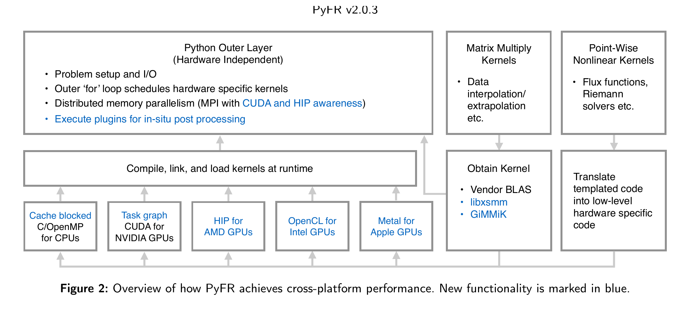
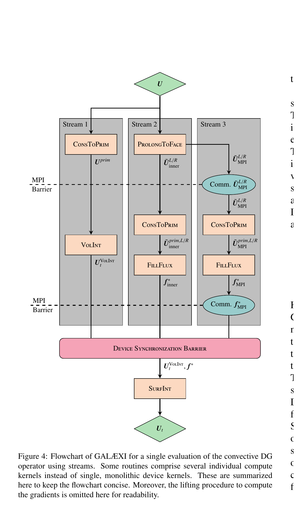
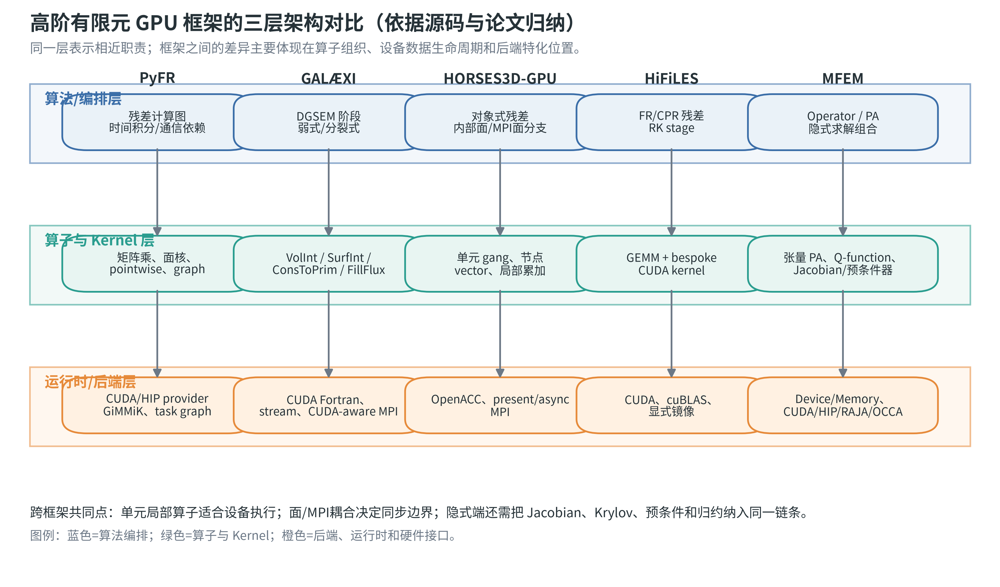
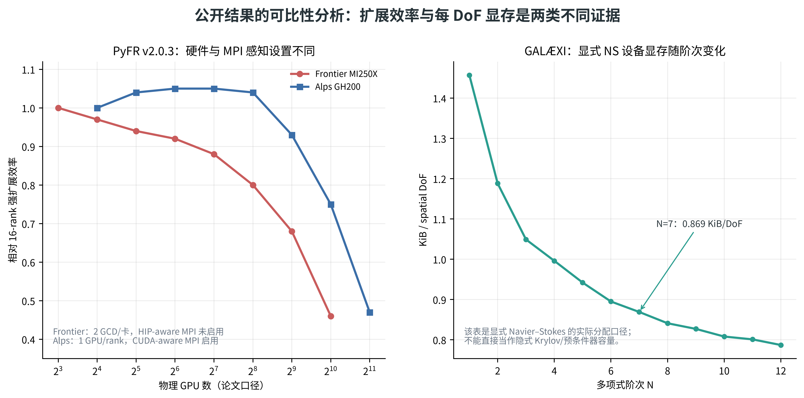

# 高阶有限元 GPU 开发框架调研与对比报告

资料截止与采集日期：2026-10-28。

## 1. 结论与适用范围

五类软件适合承担不同的参考任务：**PyFR 适合研究计算核接口、混合单元和 CUDA/HIP 后端组织；FLEXI/GALÆXI 适合研究六面体 DGSEM 的张量运算、设备常驻与多卡流水；HORSES3D-GPU 适合研究既有 Fortran 对象体系的增量 GPU 迁移；HiFiLES 适合追踪 FR/CPR 运算如何落到 GEMM 和原生 CUDA 核；MFEM 适合研究设备抽象、部分组装和隐式求解/预条件器。**没有一个框架的公开性能数字能够直接证明本项目的全部性能指标。

这一判断来自固定提交源码和原始论文的联合核查。软件之间不仅语言不同，离散方法、单元类型、物理方程、时间推进及测试硬件也不同。应按“相同计算职责”比较其实现，再在相同问题上测量；不宜给五个软件生成一个混合口径的速度排行榜。

本报告的性能数据全部为**作者公开报告的数据**，本次没有运行这些软件的 GPU 基准。已保存 7 份源码快照、25 条去重论文记录，其中 20 篇有本地 PDF；另外收录图书元数据和官方手册。论文时间窗为 2016-10-28 至 2026-10-28，4 条更早的奠基资料单独标明，不计入近十年资料。详见[文献索引与阅读摘要](../ref-paper/文献索引与阅读摘要.md)。

## 2. 软件身份与 GPU 能力边界

以下描述针对 `ref-code/` 中的固定提交。完整 SHA、默认分支、提交时间和下载校验值见 [代码清单](../metadata/code_manifest.json)。默认分支快照不等于某个正式发布版本；论文中的版本也不自动等于该快照。

| 对象         | 本地版本标识                         | 实际 GPU 路线                                             | 算法和网格定位                                              | 使用边界                                                                                        |
| ------------ | ------------------------------------ | --------------------------------------------------------- | ----------------------------------------------------------- | ----------------------------------------------------------------------------------------------- |
| PyFR         | `7139463e0609`，develop            | Python 编排；生成设备核；CUDA、HIP 等后端                 | Flux Reconstruction；按单元类型组织算子，支持混合非结构网格 | 不是通过 Kokkos 实现可移植性；论文 v2.0.3 与当前 develop 要分开                                 |
| FLEXI        | `cfa7e7cfe73e`，master             | 本次作为 GALÆXI 的 CPU/算法参照                          | 六面体 DGSEM、显式流动计算及相关扩展                        | 不能把 GALÆXI 的 GPU 测试归为该 FLEXI 快照的实测                                               |
| GALÆXI      | `1f574224fec3`，main，2024-10-11   | CUDA Fortran、多个 stream、设备数据与 MPI                 | 六面体 DGSEM，weak/split form，粘性和子单元相关路径         | 此公开 main 快照仍是 NVIDIA 路线；2026 年 CUDA/HIP C++ 接口工作单列为论文证据                   |
| HORSES3D-GPU | `c7aac6a93820`，main               | Fortran + OpenACC + MPI                                   | 六面体 DGSEM，保留对象和单元/面数据结构                     | README 明示 beta，并列出主分支部分功能不可用；不能由目录存在推断所有隐式/多物理路径均在设备执行 |
| HiFiLES      | `4c5515918566`，master，2016-01-29 | C++ + CUDA + cuBLAS + MPI                                 | ESFR/FR，多类型单元，显式 RK                                | 适合算法到核的追踪；接口较旧，当前工具链可编译性和维护状态需另行验证                            |
| MFEM         | `d259866bb8e4`，master             | Device/Memory 抽象；CUDA、HIP、RAJA、OCCA、libCEED 等分派 | 通用有限元库，部分组装、无矩阵、高阶预条件                  | 不是一个开箱即用的可压缩 DG/SA 流动求解器；应用级结果不能写成 MFEM 所有算子的性能               |

HORSES3D 主仓库 `f751d86f5536` 一并保存，用于区分原版本与 GPU 版本。代码许可文件/声明保留在各快照中；PyFR 和 MFEM 为 BSD 类条款，HORSES3D 为 MIT，FLEXI/GALÆXI 和 HiFiLES 主体有 GPL 条款。知识库保存原出处，不改变各代码的许可。GitHub 对部分仓库的许可证识别为 `NOASSERTION`，因此索引以源码声明补充说明。

证据入口：[C01–C33 源码索引](04_源码证据索引.md)，[PyFR 官方源码快照](../ref-code/PyFR)、[GALÆXI 官方源码快照](../ref-code/GALAEXI)、[HORSES3D-GPU 官方源码快照](../ref-code/HORSES3D-GPU)、[HiFiLES 官方源码快照](../ref-code/HiFiLES)、[MFEM 官方源码快照](../ref-code/MFEM)。

## 3. 软件流程设计对比

### 3.1 PyFR：以计算图连接算子与通信

`BaseAdvectionSystem._rhs_graphs` 将残差拆成面插值/交换图与通量/散度图。面值准备后可以发送，在依赖允许时计算内部面、边界面和局部通量；收到远端数据后计算 MPI 面贡献，再完成散度修正。粘性路径在 `baseadvecdiff/system.py` 中另行组织，梯度及其面交换不能从纯对流图中省略。CUDA/HIP 后端负责矩阵、核、图和数据交换对象；上层不直接为每种设备重复写同一套残差编排。

该设计的价值在于依赖关系显式，可检查“一个缓冲何时写完、通信何时允许读取、下一个核依赖什么”。局限是生成器、图执行、矩阵布局和 MPI 都构成维护面；后端可切换并不意味着图能力和运行时成熟度完全相同。[C01–C06；P01](../ref-paper/fulltext/P01_PyFR_v2.pdf)

### 3.2 FLEXI/GALÆXI：沿 DGSEM 运算阶段迁移并重叠通信

本地 GALÆXI 的 `DGTimeDerivative_weakForm` 依次调度状态到面的插值、状态交换、原始变量和梯度、体积分、梯度交换、面通量、通量交换、面积分和 Jacobian 映射。内部与 MPI 面分开处理，stream1–stream6 分担不同阶段。`VolInt` 区分 standard weak form 和 split form，不能把二者视作相同计算量。

2026 年 P09 描述了 Fortran 控制层通过接口调用 CUDA/HIP C++ 核的扩展。这对“控制流程保留、设备实现可替换”有直接参考意义，但**不属于本次下载 main 分支已经核实的实现**。后续引用该设计时，应同时写明论文与代码版本差异。[C07–C12；P02](../ref-paper/fulltext/P02_GALAEXI.pdf)、[P09](../ref-paper/fulltext/P09_GALAEXI_v2.pdf)

### 3.3 HORSES3D-GPU：保留对象结构，分离内部与跨分区工作

`ComputeTimeDerivative` 是残差入口，`TimeDerivative_ComputeQDot` 承担主要空间计算。代码按内部面、MPI 面以及不依赖/依赖 MPI 数据的单元分别执行，OpenACC 使用 gang、vector 和 async 表达设备并行。对象、指针和数组的设备生命周期仍必须被明确管理，不能只添加循环指令。

当前源码的显式时间步验证记录包含 Euler、RK5、SSPRK33/43。这里的 **Euler 时间积分**与 README 暂不支持的 `Flow equations = "Euler"` **方程选择**是两个不同概念，不应混淆。主仓库拥有某些隐式求解文件，也不构成这些路径已完成 GPU 验证的证据。[C13–C18、C32；P03](../ref-paper/fulltext/P03_HORSES3D_GPU.pdf)

### 3.4 HiFiLES：最直接的 FR 运算与设备调用对应

主循环按 RK stage 调用 `CalcResidual`；该函数将“解到通量点外推→状态交换→梯度/物理通量→公共面通量→梯度修正→散度→修正散度”串联起来。不同单元类型分别处理，线性局部算子集中为矩阵运算，非线性通量等使用 CUDA 核。

它适合解释 FR 的算子职责，但代码中的 `_GPU` 分支、显式搬运和旧 cuBLAS 调用也展示了长期维护成本。作为参考应提取算法分解、布局和核策略，而非直接延续所有旧式接口。[C19–C25；原作者论文源稿](../ref-code/HiFiLES/doc/AIAApaper/aiaa_atlanta_2014/main.tex)

### 3.5 MFEM：将离散算子、内存和设备分派分开

MFEM 的 `BilinearForm` 可选择部分组装，向上提供 `Operator`，向下由积分器调用设备核。概念上可将算子表示为限制、基函数求值、积分点物理及反向操作的组合，常见写法为 `A = PᵀGᵀBᵀDBGP`；非对称与面项需使用对应测试/试探及面限制算子，不是所有情况都只有这一个式子。

`Device` 选择执行后端，`Memory` 用 Read/Write/ReadWrite 跟踪数据有效性，预条件器可以采用另一种算子表示。尤其值得研究“高阶无矩阵作用 + 低阶组装预条件”的组合，避免将无矩阵误解为完全不保存任何矩阵。[C26–C30；P05](../ref-paper/fulltext/P05_MFEM.pdf)、[P06](../ref-paper/fulltext/P06_LOR_GPU.pdf)

## 4. Kernel 颗粒度与算子拆分

| 计算职责             | PyFR                            | GALÆXI（本地 main）                   | HORSES3D-GPU                         | HiFiLES                       | MFEM                               |
| -------------------- | ------------------------------- | -------------------------------------- | ------------------------------------ | ----------------------------- | ---------------------------------- |
| 插值、梯度、局部散度 | 固定算子矩阵乘，GiMMiK/库核选择 | 一维方向运算，节点线程映射             | 单元 gang、节点 vector，局部积分例程 | cuBLAS GEMM 与 bespoke 核     | PA 张量收缩、按单元和线程层次分解  |
| 物理通量             | 生成式 pointwise 核             | 设备通量核，区分 weak/split            | OpenACC 局部状态/通量循环            | 原生 CUDA pointwise 核        | Q 点物理；具体 PDE 由应用提供      |
| 面及边界             | 视图/索引与面核，图中依赖       | master/slave 面、插值/面积分           | 内部、边界、MPI 面分别循环           | 内部/边界/MPI interface 类    | face restriction、面积分器         |
| 批量颗粒度           | 同形状/阶次的数据批与后端分块   | 标准体积分分批；split 点级核           | 元素/面集合及 gang/vector            | 同类型元素批、块内多单元      | 单元批；核内细粒度张量线程         |
| 调优入口             | 核生成、候选计时、布局、图      | block size、批量、stream、共享内存方案 | 循环重组、vector length、局部累加    | GEMM 尺寸、自定义核、共享内存 | D1D/Q1D 专门化、共享内存、设备分派 |

**不存在通用的“一单元一个 block”结论。**例如 GALÆXI 本地 `ApplyDMatrix_Kernel` 从全局线程号解出单元和节点；HiFiLES 的 bespoke 核允许一个 block 处理多个单元；MFEM 的部分张量核采用一个单元对应一个 block 的层次；PyFR 的矩阵核按批处理和布局生成。需要依据阶次、节点数、方程分量、共享内存、寄存器及占用率共同决定。

拆分过细会产生启动、同步和中间量写回开销；融合过大又可能增加寄存器溢出、降低占用率或阻碍通信重叠。应优先检验“相邻算子是否共享数据、是否存在全局依赖、融合后资源是否可控”。设备上的局部数组也不自动意味着寄存器存储，应通过编译资源报告和 profiler 验证。[C06、C08–C09、C16、C23、C29；P16](../ref-paper/fulltext/P16_GPU_CEED.pdf)

## 5. 存储设计对比

| 对象         | 实际设计                                                                | 优势                                                 | 需要关注的成本                                                            |
| ------------ | ----------------------------------------------------------------------- | ---------------------------------------------------- | ------------------------------------------------------------------------- |
| PyFR         | AoSoA 类分块布局；对齐填充；面视图；CUDA 块宽32、HIP 读取设备 warp size | 批量访问和后端布局相配，公共算法不必暴露具体地址计算 | 填充、临时矩阵、反混叠和面 gather 仍占空间/带宽                           |
| GALÆXI      | Fortran 五维状态 `[变量,i,j,k,单元]`；独立体/面/梯度与设备数组        | 物理状态和张量方向定义清楚，设备常驻                 | 第一维连续不等于所有线程访问都合并；面缓冲和低阶表面积比影响显存          |
| HORSES3D-GPU | 单元对象内 Q、QDot、梯度及连续指针/数组；面对象单独保存                 | 保留原对象结构，较便于增量迁移                       | 深拷贝、指针绑定和设备 present 状态；每对象分配与不同阶次带来的布局复杂度 |
| HiFiLES      | 自定义 array，第一维连续；按类型拼接，独立 CPU/GPU 指针                 | 可直接解释 GEMM 的 leading dimension 与数据批        | 显式拷贝和镜像一致性；某些功能的 CPU 回传需要单独检查                     |
| MFEM         | Memory 跟踪主机/设备有效性；E/Q 向量和部分组装数据；可接入分配器        | 降低全局高阶矩阵存储，内存管理和核实现分层           | PA 工作区、积分点数据、限制映射及预条件矩阵仍有成本                       |

建议知识库中统一区分 `Nnode`（空间节点数）、`Nscalar = nvar × Nnode`（标量未知量数）及论文原始 DoF。显存至少分成状态/阶段向量、几何、体和面中间量、通信、求解器/预条件器、运行时及临时分配七类。显式方法的 bytes/DoF 不能直接用于估算隐式 Krylov 基、雅可比或预条件器容量。

MFEM 官网性能页有“单纯形 PA 尚未支持”的历史说明，但本次 master 已含 `bilininteg_diffusion_pa_simplices.hpp` 和 `...mass_pa_simplices.hpp`。正确结论是**存在特定单纯形实现，需要逐积分器确认支持范围**；不能照搬旧网页，也不能由这两个文件推断全部单纯形算子都可用。[C30；官方说明快照](../ref-paper/manuals/M05_MFEM_PA.html)

## 6. 性能证据与可比性

完整记录见[性能证据表](02_性能证据与对标口径.md)和[CSV](raw_data/性能证据表.csv)。以下摘取能定位到原文的结果：

| 框架/应用        | 已核实的公开结果                                                                          | 正确解释                                                                                                 |
| ---------------- | ----------------------------------------------------------------------------------------- | -------------------------------------------------------------------------------------------------------- |
| PyFR v2.0.3      | TGV、七次多项式、13,891,500 四面体、FP64；2048 ranks 时 Frontier/Alps 强扩展效率约46%/47% | 基准是16 ranks；Frontier每卡2个 GCD且未启用 HIP-aware MPI，Alps启用 CUDA-aware MPI。不是“2048卡弱扩展” |
| GALÆXI P02      | A100 上扩展测试至1024 GPU；N=7 时每空间 DoF 0.869 KiB，40 GiB可容纳约4800万空间 DoF       | 显式 Navier–Stokes 的实际分配数据；不能把空间 DoF 与全部守恒变量个数混算                                |
| HORSES3D-GPU P03 | H100；P=5、每卡16,384单元，256卡弱扩展约90%，基准为4卡单节点                              | 对应 TGV 测试；CRM展示扩展到2048卡不能自动继承该90%数字                                                  |
| HiFiLES README   | 声称16卡强扩展约88%、弱扩展超过90%                                                        | README未给足硬件、网格和计时口径；保留为低完整度历史声明，不作为严格横向比较数值                         |
| MFEM LOR P06     | V100；1.1×10⁹ DoF问题在256卡的弱扩展：setup约83%、solve约87%；测试范围4–1024卡         | 是特定有限元预条件求解研究；不是可压缩 DG 完整时间推进性能                                               |
| MARBL/MFEM P07   | 12张16 GB V100上，内存优化版本合计显存从181 GB降为97.3 GB                                 | 是12卡合计的应用级分配，不是每卡，更不是MFEM固定bytes/DoF                                                |
| GALÆXI APU P10  | MI300A，N=9，每APU 409.6万 DoF，512 APU弱扩展90.4%，基准单节点                            | 2026年预印本；AMD HIP/APU结果不能直接替代曙光DCU/DTK验证                                                 |

单卡方面，GALÆXI 和 HORSES3D-GPU 提供负载/PID曲线，MFEM有算子及求解器分项测试；PyFR的大规模固定问题以多卡作为起点，因此“每rank归一化吞吐”不能伪装成独立单卡实测。HiFiLES缺少足够完整的现代硬件单卡证据。报告保留这些缺口，而不从显卡峰值推算软件加速比。

## 7. 面向后续开发的参考分工

本节仅给出第③项设计工作的证据输入，不预先确定 HyRES 的改造方案。

| 后续需要解决的问题        | 首选阅读对象                      | 对比对象                           | 需要从第①项补齐的 HyRES 信息                 |
| ------------------------- | --------------------------------- | ---------------------------------- | --------------------------------------------- |
| 算法与后端解耦            | PyFR 后端接口；MFEM Device/Memory | GALÆXI 2026 Fortran/C++ 接口论文  | 现有算子职责、调用边界和数据所有权            |
| FR/CPR 混合单元的批量运算 | PyFR、HiFiLES                     | MFEM 相应单元的局部算子            | 实际单元分组、阶次和矩阵尺寸分布              |
| 六面体高阶体积分          | GALÆXI、HORSES3D-GPU             | MFEM 张量核                        | 张量结构是否可用、基/积分点选择、反混叠需求   |
| MPI 重叠与设备驻留        | PyFR 图；GALÆXI stream           | HORSES3D-GPU 内部/MPI 集合划分     | halo 内容、真实依赖和通信热点                 |
| 隐式与预条件              | MFEM LOR、P18、PETSc GPU 文献     | 其他框架的显式残差作为局部部件参照 | 雅可比策略、Krylov/预条件调用和端到端迭代开销 |
| 显存控制                  | MFEM/MARBL 生命周期与池化         | PyFR scratch、GALÆXI 每DoF统计    | 全部向量/矩阵大小、生命周期和峰值             |
| 原生核与可移植后端共存    | MFEM分派、PyFR provider           | Kokkos手册及模型比较论文           | 接口能否表达布局、stream、同步和缓冲归属      |

对抽象层的调研结论是：它应明确表达计算职责和数据/执行约定，而不仅包一层 `parallel_for`。可替换性同时取决于数据布局、异步完成语义、内存所有权、错误传播及库互操作。若这些约定缺失，单独替换一个计算核也可能引入隐式拷贝或跨 stream 竞态。这是由上述框架的接口职责归纳出的工程判断，不是已经在 HyRES 上测得的结论。

## 8. 本次交付与剩余证据边界

- 源码均固定提交并保存校验清单；未改动 HyRES 或这些参考实现的算法。
- 文献按 DOI/arXiv 去重，保留预印本日期与正式出版信息；预印本不标成已同行评审。
- 已下载的论文和手册提供离线文件；仅取得元数据的文献/图书明确标识，未冒称全文已阅读。
- 已形成软件流程、颗粒度、算子拆分、存储和性能对比；源码事实和论文事实分别定位。
- 待未来具备统一硬件与配置时，才能生成可直接排序的实测结果；执行规范和空白数据模板已提供，不能将其看作已完成实验。
- 按用户本次要求不推送。后续第①项应提供 HyRES 自身的调用及热点证据，再结合这里的参考分工讨论第③项整体设计。

## 9. 进一步的统一分析框架

前面的比较回答“每个软件是什么”，本节回答“同一项 GPU 改造应该比较什么”。高阶有限元/间断有限元程序的性能不是由单个 Kernel 决定，而是由五层共同决定：

| 层次     | 需要确认的对象                              | 典型失效表现                         | 评审时必须保留的证据                           |
| -------- | ------------------------------------------- | ------------------------------------ | ---------------------------------------------- |
| 数值层   | 基函数、数值通量、梯度、时间推进、线性化    | GPU结果与CPU误差不同、迭代数增加     | 误差范数、守恒量、收敛阶、迭代轨迹             |
| 数据层   | 自由度排列、单元分组、面邻接、几何量        | 访存不合并、gather/scatter代价高     | 数组形状、leading dimension、padding、峰值显存 |
| Kernel层 | 插值、通量、导数、面积分、归约              | 启动过多、寄存器溢出、低占用率       | kernel耗时、带宽、算术强度、寄存器/共享内存    |
| 调度层   | stream、事件、图、MPI、归约                 | 计算等待通信、同步过多、异步计时失真 | 完成事件、依赖图、MPI等待时间、同步次数        |
| 求解层   | Newton/Krylov、Jacobian、预条件器、停止准则 | 单步变快但端到端变慢                 | 外迭代、线性迭代、残差评估、总耗时             |

因此，比较“某软件有没有 GPU 版本”只完成了能力检查；比较“某软件能否作为 HyRES 参考”还要问：它的算子是否与 HyRES 同构、数据布局是否可映射、隐式链条是否覆盖、通信是否设备直达、性能数据是否有相同计时边界。

### 9.1 参考价值评分的定义

为避免凭印象排序，本报告采用四个定性维度：

- **算法同构性**：参考软件的离散算子和 HyRES 的 DG/CPR、阶次、单元、边界、物理模型相似程度。
- **执行路径可观察性**：是否能从源码定位到残差入口、Kernel、数据分配、MPI和同步。
- **后端可替换性**：设备实现是否通过 provider、Device、Memory、C/C++接口或其他边界隔离。
- **隐式相关性**：是否包含 Jacobian、Krylov、预条件器或隐式时间推进，还是只有显式残差。

| 框架          | 算法同构性        | 执行路径可观察性              | 后端可替换性                     | 隐式相关性                          | 适合优先研究的内容                          |
| ------------- | ----------------- | ----------------------------- | -------------------------------- | ----------------------------------- | ------------------------------------------- |
| PyFR          | 高（FR/高阶流动） | 高（图和provider清楚）        | 高（CUDA/HIP provider）          | 中（主要公开GPU证据偏显式）         | 后端接口、图依赖、混合单元、生成核          |
| FLEXI/GALÆXI | 高（DGSEM）       | 高（Fortran残差与设备核对应） | 中至高（论文新路线高，main较低） | 低至中                              | 高阶体积分、stream、设备驻留、MPI面交换     |
| HORSES3D-GPU  | 高（DGSEM/NS）    | 高（Fortran对象与OpenACC）    | 中（指令模型依赖编译器）         | 中（主版有隐式部件，GPU覆盖需验证） | 增量迁移、对象数据生命周期、内部/MPI分离    |
| HiFiLES       | 中高（FR/多单元） | 高（C++函数与CUDA核直接）     | 低至中                           | 低                                  | GEMM/自定义核、共享内存、主机中转通信的代价 |
| MFEM          | 中（通用有限元）  | 高（Operator/Memory/Device）  | 高                               | 高（LOR/AMG/线性求解）              | 抽象接口、部分组装、预条件、内存生命周期    |

这个表是“参考工作量”的排序，不是软件质量排名。比如 MFEM 的算法同构性不如 DG 专用代码，但对隐式求解和后端抽象的参考价值更高；HORSES3D-GPU 的后端抽象不如 MFEM，但对保留 Fortran 对象结构进行增量迁移更贴近工程现实。

## 10. 五个框架的实现剖面

### 10.1 PyFR：图执行和布局是一个整体

PyFR 的核心不是单独的 CUDA/HIP 文件，而是“上层算子描述—后端 provider—设备矩阵/视图—执行图”这条链。`BaseAdvectionSystem` 先准备不同单元类型的面视图，再创建 MPI 请求和 Kernel 依赖；`BaseAdvectionDiffusionSystem` 在此基础上插入梯度、人工黏性/熵滤波和额外面数据。这样做的直接效果是：

1. 同一残差职责可以由不同后端 provider 实现；
2. 面打包、通信和局部计算的依赖可以记录在图里；
3. 输入输出寄存器与临时矩阵由后端统一管理；
4. 不同阶次或单元类型可以使用不同布局和 Kernel。

代价也很明确：图的正确性、MPI请求生命周期、provider缓存和布局填充共同构成复杂状态。HyRES若借鉴该方式，应该先抽取“残差阶段和数据依赖”，再决定是否需要图执行；不能先引入图，再把现有函数逐个包成节点。

### 10.2 GALÆXI：设备常驻与多 stream 的收益受通信同步限制

GALÆXI 的公开代码体现了典型的 Fortran 高阶 DG GPU路线：主状态、几何、导数矩阵和工作数组有设备副本；残差阶段按状态、梯度、体积分、面通量和面积分推进；多个 stream 用于表达可并发阶段。可是 `StartSendMPIData_GPU` 在发送设备缓冲前同步对应 stream，未给出 stream 时甚至同步设备。因此实际收益取决于：

- MPI实现是否能读取设备指针；
- stream同步是否只等待发送缓冲对应事件；
- 接收缓冲是否在设备上直接可用；
- 内部面和边界面是否足够多，能否覆盖同步等待；
- 阶次和单元数是否使 Kernel计算时间超过通信启动成本。

这类代码适合用来设计“设备常驻—事件—MPI—面核”的检查项，不能只复制 stream 数量。

### 10.3 HORSES3D-GPU：迁移重点是对象图，而不是 pragma 数量

HORSES3D-GPU 的 OpenACC 循环嵌套易于阅读，但 `present(mesh)` 背后包含 mesh、element、storage、geometry、physics 等对象关系。增量迁移的主要风险是：

- 子对象未进入设备或设备端指针仍指向主机地址；
- 某个诊断/输出分支触发隐式回传；
- 内部面和 MPI 面采用不同数组，更新顺序不一致；
- OpenACC async 队列之间没有显式等待，导致下游读取未完成数据；
- 隐式求解器仍在CPU上，而残差核在GPU上，反复搬运抵消收益。

因此，HORSES3D-GPU最值得借鉴的是迁移清单和数据生命周期管理；它的具体 `num_gangs`、`vector_length` 不能作为 HyRES 的默认调参值。

### 10.4 HiFiLES：线性算子与非线性物理核需要分开优化

HiFiLES 将插值、导数和散度等固定线性运算交给 GEMM 或自定义矩阵核，将数值通量、边界和局部物理处理交给 pointwise Kernel。二者的瓶颈不同：

- GEMM 更接近计算/访存库的可预测路径，关键是矩阵形状、批量和布局；
- 数值通量通常受寄存器、分支、面索引和数据重用影响；
- 面通信需要打包、MPI、等待、解包，不能计入单纯 Kernel 加速；
- 当前参考代码的设备到主机回传说明“GPU残差”不等于“GPU完整时间步”。

对 HyRES 的直接启发是建立算子类别，而不是只按源文件划分：固定矩阵类、点物理类、面耦合类、归约类、求解器类、I/O类分别计时。

### 10.5 MFEM：抽象接口必须携带数据和同步语义

MFEM 的 `Device`、`Memory` 和 `Operator` 说明抽象层至少需要表达：执行空间、数据有效性、读写意图、算子作用、边界约束和后端选择。若抽象层只有 `launch(kernel)`，以下问题无法被统一处理：

- 当前数据是否已在设备上；
- Kernel是否允许异步返回；
- 输出缓冲何时可供 MPI 或下一 Kernel读取；
- 临时空间是否来自池化分配器；
- 原生 CUDA 特化如何与公共算子保持同一误差和停止准则。

MFEM的参考意义是接口的“语义完整性”，不是要求 HyRES 采用 MFEM 的类层次或全套库。

## 11. 比较结论

1. **算法参考首选 PyFR、GALÆXI/HORSES3D-GPU、HiFiLES**：它们能把高阶空间离散、面耦合和设备 Kernel 对上。
2. **隐式参考首选 MFEM LOR/AMG、GPU DG 不可压缩求解器及 PETSc 论文**：它们能补齐显式框架缺少的线性求解和预条件器视角。
3. **后端抽象参考首选 MFEM、PyFR provider、P09所述 Fortran/C++边界**：这些资料共同说明抽象层需要覆盖执行、内存和算子，而不是只包装线程循环。
4. **多 GPU 参考必须结合通信实现阅读**：同样写着 MPI+GPU，可能分别对应设备直达、stream同步后直发、主机中转三种路径，性能意义不同。
5. **性能数字必须绑定问题和硬件**：不能用 GALÆXI 的显式每DoF显存估计 HyRES 隐式容量，也不能用 HORSES3D-GPU 的 TGV 弱扩展比例替代 HyRES 翼身组合体结果。

## 12. 图表化架构与结果分析

本节把前文的文字比较落到可审查的图表。原文图仅做裁切和分辨率处理，图内语义、颜色和数值保持原文含义；自绘图使用本知识库已保存的源码证据、文献表格或 CSV，不补造未公开数据。

### 12.1 原文摘取：PyFR 的跨平台架构

**图12-1说明。**图源为 P01《PyFR v2.0.3》PDF 第5页 Figure 2。原文将 Python 外层、运行时编译/链接、矩阵乘与点级非线性核、以及 CPU/CUDA/HIP/OpenCL/Metal 等后端分开表示。对本项目最有价值的不是“支持多少后端”这一表面结论，而是上层调度和下层设备核之间存在稳定的职责边界；矩阵核与点物理核可以通过不同 provider 实现，MPI 也被纳入上层分布式执行语义。

**对照结论。**该图支持“公共算法层+后端实现层”的架构方向，但不证明每个后端的所有算例、精度和通信功能都已等价。PyFR 的 DSL、provider、图执行和缓存是一个整体，移植到 HyRES 时需要重新定义数据布局、异步事件、设备内存所有权和错误回退契约。

### 12.2 原文摘取：GALÆXI 的多 stream DG 流程

**图12-2说明。**图源为 P02《GALÆXI》PDF 第8页 Figure 4。原文把 Stream 1 的单元内操作、Stream 2 的内部面操作和 Stream 3 的 MPI 面操作分开，并在 MPI barrier、设备同步 barrier 处显式收敛。图中同时给出了通信启动和本地体积分的重叠机会，以及通信完成后才能执行的面通量和面积分。

**结果边界。**多 stream 只说明存在可调度的并发关系；发送前的 stream 完成、接收后的等待和设备同步仍然可能成为关键成本。因此，评审 HyRES 的“通信与计算重叠”时应复现同样的事件链，而不能只统计 stream 数量或异步 API 调用数。

### 12.3 自绘：五类框架的三层架构对照

**图12-3绘制依据。**图中内容由 C01–C30 源码证据和 P01–P07、P16、P19、P20 文献归纳。每一列只保留能在源码或论文中定位的主要职责：PyFR 的 provider/graph，GALÆXI 的 DGSEM stages/streams，HORSES3D-GPU 的对象式 OpenACC，HiFiLES 的 GEMM+bespoke CUDA，MFEM 的 Device/Memory/PA/Operator。

**架构分析。**五个框架都可抽象为算法编排、算子/Kernel、运行时/后端三层，但层间边界的位置不同。PyFR 和 MFEM 的公共抽象较显式；GALÆXI 与 HORSES3D-GPU 更贴近既有 Fortran 数据结构；HiFiLES 通过矩阵库和原生核组织 FR 算子。对 HyRES 而言，Kokkos 更适合承载执行空间、视图和并行策略，不能替代物理算子、MPI halo 和隐式求解器的接口设计；关键核仍可在同一契约下接入 HIP/CUDA/DCU 特化。

### 12.4 自绘：公开性能证据的双面板比较

**图12-4数据来源。**左图直接读取 `raw_data/PyFR强扩展原始表.csv`，对应 P01 PDF 第17页 Tables 2–3；右图直接读取 `raw_data/GALAEXI显存原始表.csv`，对应 P02 PDF 第13页 Table 2。图中没有把不同软件的指标合并成单一排行榜。

**结果分析。**PyFR 两条曲线在 1024 个物理 GPU 以后均明显下降，但下降幅度不能只归因于软件：Frontier 使用 MI250X 的 GCD 口径且未启用 HIP-aware MPI，Alps 使用 GH200 且启用 CUDA-aware MPI。GALÆXI 的每 DoF 显存随 N 增大而下降，反映体数据与面数据的比例变化和显式存储布局；它是显式 Navier–Stokes 的设备分配结果，不含 HyRES 隐式 Krylov 基、Jacobian 工作区和预条件器容量。

**可迁移的测量方法。**后续 HyRES 复测应同时保存物理 GPU/GCD 定义、MPI 感知模式、全局/局部 DoF、精度和计时边界；显存曲线则要按状态、几何、面通信、Krylov、预条件器和临时池分项记录。只有在算例、硬件、精度和停止准则一致时，曲线才可用于版本间比较。

### 12.5 图表对应的实现检查项

| 图表中观察到的现象     | 对 HyRES 的检查项                                   | 不能直接推出的结论                 |
| ---------------------- | --------------------------------------------------- | ---------------------------------- |
| 算法层与后端层可分离   | 明确算子输入/输出、layout、stream/event、内存所有权 | 不能仅凭接口存在证明各后端性能等价 |
| 多 stream 存在局部重叠 | 记录 pack、MPI、wait、unpack 和面通量的时间线       | 异步调用不等于通信已隐藏           |
| 高阶显存/DoF随阶次变化 | 统计体、面、几何、临时和求解器工作区                | 显式显存口径不能直接代表隐式容量   |
| 大规模强扩展效率下降   | 扫描每卡 DoF、通信字节和归约频率                    | 不能把他人硬件阈值当作 HyRES 指标  |

本节的原文图和自绘图共同支持“分层接口、设备常驻、事件可审计、端到端测量”的设计判断；最终参数仍需回到 HyRES 源码、任务书算例和目标 DCU 实测。
