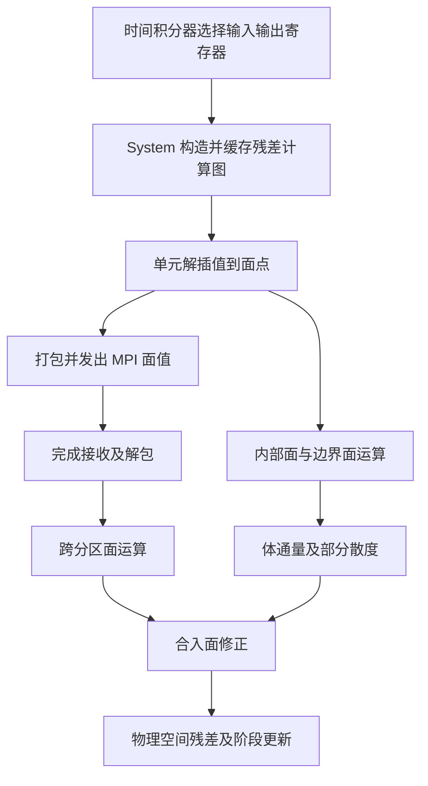
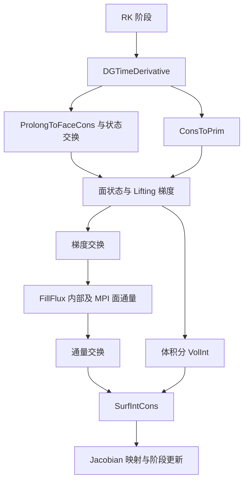
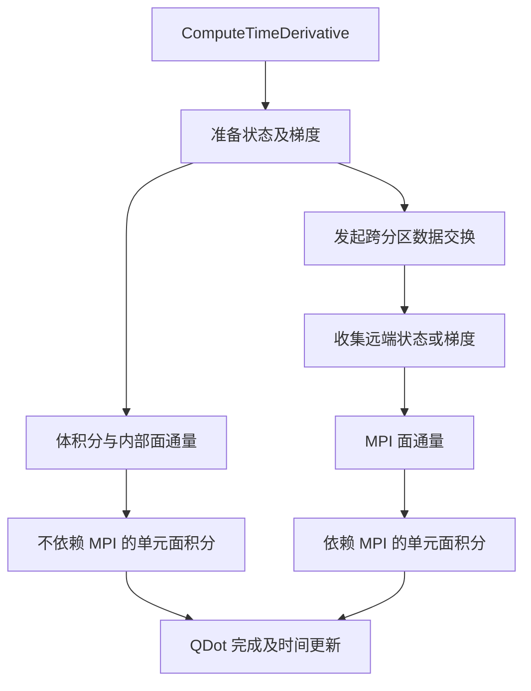
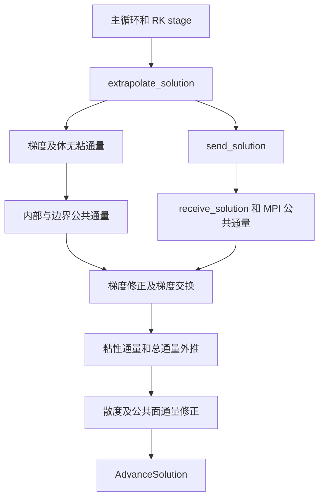
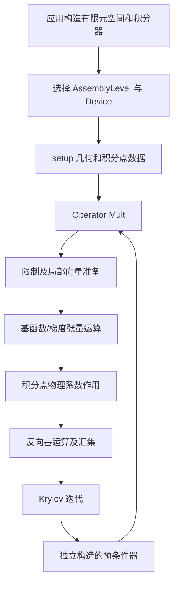
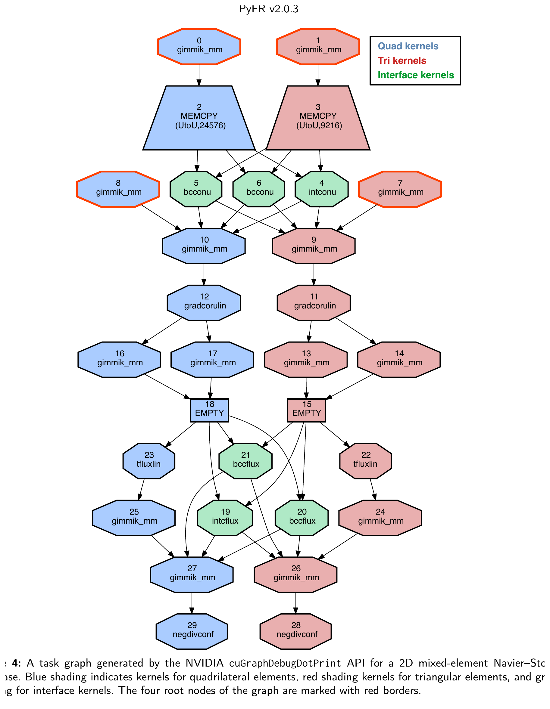
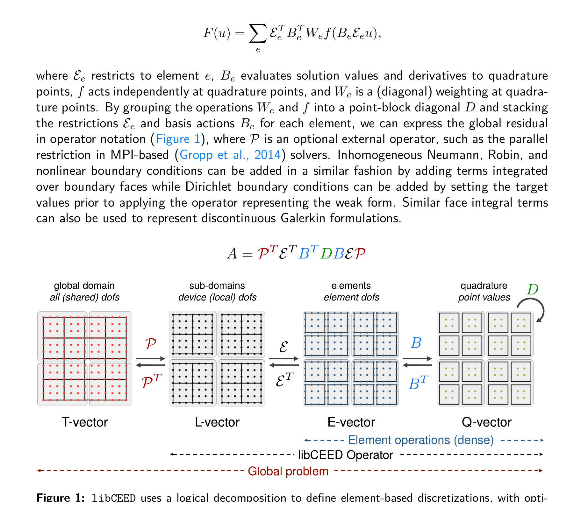
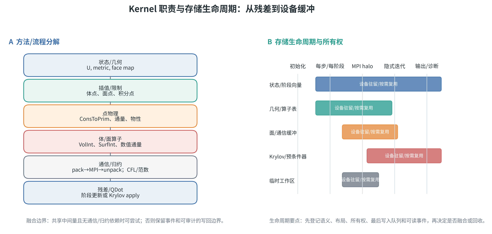
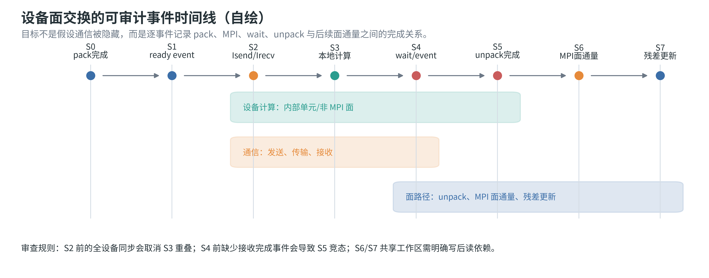

# 软件流程、Kernel 与存储设计详解

以下是根据固定提交源码重建的职责流程，并非运行 profiler 得到的调用栈。图中为可读性省略了配置分支和诊断操作；开启粘性、限制器、反混叠等功能后，还需沿具体分支核查。行号和在线固定提交链接统一在[源码证据索引](04_源码证据索引.md)。

## 1. PyFR

### 1.1 职责流程



对流路径见C01。Navier–Stokes还需公共解、修正梯度、梯度面交换与粘性通量，具体顺序见C02。图的意义在于将计算依赖交给后端调度，而非假定所有箭头都按单一CPU串行顺序执行。

### 1.2 接口与颗粒度

上层向 `backend.kernel(...)` 请求计算职责；provider 提供 pointwise、矩阵乘、打包、线性代数等实现。CUDA GiMMiK provider 只接受常矩阵，检查维度、生成候选、计时并缓存；不合适时抛出 `NotSuitableError` 交由其他实现处理。此处是“相同算子允许多个实现”的直接代码证据，不能理解为任何计算都必须生成代码。

CUDA和HIP后端都配置自己的matrix/view/graph对象。当前CUDA `soasz=32`，HIP读取设备 `warp_size`；这体现逻辑布局与后端参数分离。矩阵带有padding、leading dimension和块信息，不能只从Python输入数组的形状推断设备存储。

### 1.3 值得对标的最小部件

- 固定插值/求导矩阵作用：比较标准库、生成核及张量算法的工作量和时间，记录矩阵形状与阶次。
- 面打包/通量：区分连续批处理和间接索引；小问题要记录启动成本。
- 同一残差图在CUDA/HIP上的执行：记录图支持、MPI模式与实际同步，不仅记录“成功编译”。

**不能直接迁移的假设**：PyFR自己的DSL、矩阵包装和缓存机制是一套完整系统；HyRES是否适合类似结构仍需其数据与调用分析。依据C01–C06、P01；本文不主张重写为Python。

## 2. FLEXI / GALÆXI

### 2.1 职责流程



不同stream允许部分阶段重叠，但源码中的MPI发送前会同步对应stream；没有传stream时使用设备同步。这是保证通信读到已完成数据的措施，也可能成为瓶颈。不能仅凭存在多个stream就宣称全部通信已隐藏。接收和发送直接使用设备数组，部署时需要相应MPI能力。证据为 `src/mpi/mpi.f90:277–387`。

### 2.2 Kernel 细化

- weak-form体积分按 `nElems_Block_volInt` 分批，计算通量后应用方向求导。
- `ApplyDMatrix_Kernel` 将线程号解码为 `ElemID,i,j,k`，一个线程累积该节点多个变量的方向贡献。
- split-form核对当前节点与方向邻节点的两点通量累加，运算量和临时量不同于weak-form。
- 因此“GPU高阶DG”不是单一核；同一代码中不同离散形式也应分别评估。

### 2.3 存储和新旧路线

主状态为 `[nvar,0:N,0:N,0:N,nelem]`，第一维为变量；体、面、梯度和通量有各自缓冲。CPU和设备数组显式存在。面数据随 `(N+1)^2` 增长，体数据随 `(N+1)^3` 增长，因此每空间DoF占用会随阶次改变。

本地FLEXI文档可作为算法解释入口，GALÆXI main作为CUDA Fortran实现入口。P09/P10讨论的Fortran→C++ CUDA/HIP路线单列为扩展阅读；本次下载的main没有被替换为论文描述的新架构。依据C07–C12、P02/P09/P10。

## 3. HORSES3D-GPU

### 3.1 职责流程



图对应主要NS路径；HO/isolated模式是其他入口，不将它们合并成一个实际调用栈。开启ShockCapturing等配置可能增加通信和同步，当前代码还存在相关barrier，必须结合配置分析。

### 3.2 颗粒度和数据

外层单元循环映射到OpenACC gang，内层节点循环使用vector与collapse。`SpatialDiscretization.f90:1313` 有 `vector_length(128)`、`num_gangs(9700)` 等具体参数；它们是当前实现选择，不是适用于所有硬件/网格的通用参数。

单元对象内保存Q、QDot、梯度、物理辅助量及几何；面对象保存面状态和面贡献。使用 `present(mesh)` 意味着对象和相关数据必须事先正确进入设备，并不自动解决所有指针深拷贝问题。原Fortran对象模型被保留，对增量迁移有参考意义，但可能增加设备内存管理和重分配成本。

P03特别讨论局部累加减少全局写回，标准DG与split form需要不同优化。检验点应包含节点循环的合并访问、寄存器/局部内存占用、两点通量是否被完整物化、单元阶次变化后的布局重建。

### 3.3 功能范围检查

README中的GPU限制优先于主版宣传。`.ns`和`.mu`之外的路径、BR2/IP、某些变量形式及隐式功能，不能由主仓库存在相同文件就认定GPU支持。当前NEWS的显式积分验证也不能覆盖所有求解器组合。依据C13–C18、C32和P03；真实支持矩阵仍需编译运行相应算例确认。

## 4. HiFiLES

### 4.1 职责流程



以上粘性阶段只在对应配置启用时存在。`solver.cpp` 中某些体力计算会把状态从设备复制到CPU，不能将主残差大部分在GPU上执行概括成“完整求解无回传”。

### 4.2 矩阵和 CUDA 核

`eles::extrapolate_solution` 以固定插值矩阵乘同类型元素组成的状态矩阵；梯度、散度、lift等复用这种形式。原代码使用旧式 `cublasDgemm` 等调用。非线性通量与面运算用原生核，`bespoke_SPMV_kernel` 内一块处理多个单元，一个线程对应输出点，共享内存缓存输入，并有避免bank冲突的padding。

这是“不要按C++函数边界机械拆核”的例子：应看函数是否只是一个批量线性算子，或包含适合融合的点级物理计算。旧核的常量和共享内存策略应重新测量，不能把HALFWARP=16等历史选择直接移到新设备。

### 4.3 通信路径的具体限制

`mpi_inters::send_solution` 先设备打包，随后 `cp_gpu_cpu`，再对CPU缓冲调用 `MPI_Isend/Irecv`；接收完成后 `cp_cpu_gpu`。所以本地HiFiLES参考是**主机中转MPI路径**，不是已验证的GPU-direct通信。其性能声明需要在这一历史实现背景下理解。代码位置：`src/mpi_inters.cpp:274–332`。

## 5. MFEM

### 5.1 职责流程



该图是库组件职责，不表示ex1一定使用某一分布式预条件器。应按具体应用和算子选择补齐通信、非线性及边界消元。

### 5.2 部分组装与核颗粒度

PA不形成全局高阶稀疏矩阵，保留必要积分点信息并即时执行基函数作用。三维扩散核以单元为外层，线程处理张量方向；使用共享存储载入基矩阵和中间量。当前实现既有二维批量形式，也有三维线程形式，应依据D1D/Q1D、几何和资源决定适用核。

全矩阵/局部矩阵/PA/完全matrix-free是不同选择。省去高阶全局矩阵并不会省去预条件器所需的低阶矩阵。P06通过LOR矩阵、AMG与高阶算子结合，明确展示setup与apply分开的设计，适合作为隐式设计的参考。

### 5.3 Memory 和替换后端

`Read`、`Write`、`ReadWrite`具有不同的有效性与搬运语义；纯写入不必先复制旧值。Device配置与核分派分层，使同一Operator可以有不同实现。若未来接入原生CUDA核，仍需遵守对象的数据有效性、生命周期和stream约定，不能绕过Memory管理后让上层继续使用过期镜像。

官方网页与最新源码存在细节差异，具体能力以选定提交、积分器与测试为准。应用级MARBL结果仅用于说明生命周期/分配池的重要性，不作为MFEM某个库函数的性能标称。

## 6. 跨框架可提炼的设计原则

1. 将物理定义、离散算子、数据布局、执行调度及通信依赖分开表达；它们可以协同优化，但不宜互相隐式依赖。
2. 同一职责保留多个实现候选：矩阵库、生成核、张量核、原生特化；选择依据应包含数值一致性和完整流程性能。
3. 将状态和主要工作区长期驻留设备；临时空间按生命周期复用；回传由输出、诊断或算法真正需要决定。
4. MPI调用、设备核和stream之间建立明确完成关系；非阻塞调用本身不证明存在有效重叠。
5. 显式残差加速只能说明一个组成部分；隐式必须计入线性化、预条件、归约、迭代次数和收敛所需总时间。

以上属于由参考框架归纳出的原则。本次尚未以HyRES代码证据确定其具体接口或实施步骤。

## 7. Kernel 的共同解剖方法

不同框架的函数名不同，但高阶 DG/FR 残差通常可以拆成以下七类职责。评审和后续移植应按职责追踪，而不是按文件扩展名追踪：

| Kernel类别       | 输入                        | 输出                   | 常见数据依赖                   | 主要性能风险                       |
| ---------------- | --------------------------- | ---------------------- | ------------------------------ | ---------------------------------- |
| 状态插值/限制    | 单元节点值、基函数/导数矩阵 | 体点、面点、积分点值   | 同一单元局部读，多方向张量操作 | 矩阵重复加载、寄存器和共享内存     |
| 物理状态转换     | 守恒量、几何/物性           | 原始变量、声速、黏度等 | 点级独立，可能有分支           | 除法、平方根、模型分支、低算术强度 |
| 体通量           | 原始变量、梯度、几何        | 对流/粘性通量          | 单点及局部邻点                 | 临时量过多，寄存器溢出             |
| 面通量           | 两侧状态、法向、边界数据    | 数值通量、梯度修正     | 面邻接、边界类型、MPI halo     | 非连续访问、分支、gather/scatter   |
| 导数/散度/面积分 | 通量、导数矩阵、质量矩阵    | 残差/QDot              | 方向耦合和写回                 | 全局内存往返、原子或竞态           |
| 归约             | 波速、残差、内积            | 标量/分区标量          | block内及跨rank归约            | 同步和通信延迟                     |
| 数据交换         | 面缓冲、邻接表、MPI请求     | halo/远端面数据        | pack→send→wait→unpack       | 主机中转、设备同步、临时缓冲       |

### 7.1 固定线性算子 Kernel

插值、导数、lift和部分组装通常包含一个固定矩阵或张量。可选择三类实现：

```text
全矩阵 GEMM：        C = A × B
张量分解：            C(i,j,k) = Σ_l D(i,l) × B(l,j,k)
专用点核：            一个线程/warp/block处理节点或单元，融合读写
```

GEMM易于调用成熟库，但中小矩阵和不规则批量可能受启动/布局影响；张量分解减少存储和运算，但需要精心安排共享内存；专用点核可融合物理和导数，但更容易受阶次、寄存器和硬件差异影响。HiFiLES、GALÆXI、MFEM分别展示了这三种方向的不同组合。[C08–C09、C21–C23、C29]

### 7.2 点级物理 Kernel

点级 Kernel 常见结构是：

```text
load U / geometry
→ conservative_to_primitive(U)
→ evaluate_physical_model(...)
→ compute_inviscid_flux / viscous_flux
→ transform_by_metric
→ store flux or residual
```

适合融合的条件是输入生命周期相近、输出只被下一阶段使用一次、寄存器和共享内存可控；不适合融合的条件是结果需要MPI交换、多个后续算子复用或包含不同同步范围。评审时应记录每个中间量是否落到全局显存，以及融合前后写回次数。

### 7.3 面和MPI Kernel

面路径不能只看数值通量函数。完整路径是：

```text
面索引/邻接准备
→ 单元面值提取或插值
→ local face pack
→ MPI Isend/Irecv 或设备直达通信
→ wait/event
→ unpack / 面状态重排
→ internal/boundary/MPI numerical flux
→ surface integral / residual update
```

PyFR把这些阶段纳入图依赖；GALÆXI在设备缓冲上收发并在发送前同步stream；HiFiLES先回传主机再MPI；HORSES3D-GPU按OpenACC对象和MPI面集合组织。四种方式即使最终调用的MPI函数名称相同，通信成本也不同。[C01、C12、C15、C33]

### 7.4 归约 Kernel

显式时间步至少有最大波速/CFL、监控量和输出判据；隐式还增加残差范数、点积、线搜索和全局收敛判断。归约通常是短Kernel，却可能在多卡中决定同步频率。应记录：本地归约时间、跨rank归约时间、调用次数、是否与其他计算重叠，以及归约结果是否影响下一Kernel的执行路径。

## 8. 各框架的存储生命周期

### 8.1 PyFR：视图、分块和临时寄存器

PyFR的存储可按四类理解：

1. **主状态 bank**：输入输出寄存器，用于时间阶段和残差；
2. **单元/面视图**：从单元存储构造内部、边界、MPI面视图；
3. **后端矩阵与Kernel工作区**：包含padding、块宽、leading dimension和专用矩阵乘缓存；
4. **通信和临时空间**：打包缓冲、接收缓冲、熵滤波/人工黏性附加数据。

其优点是公共算法不需要知道设备地址，代价是视图和布局切片带来索引复杂度。检查内存峰值时应把bank、view背后的同一分配去重，不能把每个view都算成独立显存。

### 8.2 GALÆXI：显式镜像和阶次相关数组

本地代码中的状态是多维数组，设备数组以 `d_` 前缀区分。典型分配包括：

```text
U/U_t                         变量 × (N+1)^3 × 单元
面状态                         变量 × (N+1)^2 × 面
梯度                           变量/梯度分量 × (N+1)^3 × 单元
通量                           变量 × 方向 × (N+1)^3 × 单元
导数/质量/几何                 (N+1)^2 或 (N+1)^3 的表与度量
```

当 `N` 增加时，体数组按 `(N+1)^3` 增长，面数组按 `(N+1)^2` 增长；面/体比例下降并不代表所有工作数组都按同一比例下降。隐式方案还需要阶段向量、Jacobian作用工作区、Krylov基和预条件器存储。

### 8.3 HORSES3D-GPU：Fortran对象和设备指针

对象型存储要区分：

```text
mesh对象 → element集合 / face集合 / geometry
       → element%storage%Q, QDot, U_x/U_y/U_z, flux
       → physics model / boundary / MPI metadata
```

`present(mesh)` 只在设备数据环境已正确建立时有意义。若使用对象数组、指针或可分配组件，需检查编译器对深拷贝和设备指针的处理。建议在迁移阶段增加对象级内存审计：每个字段的主机地址、设备地址、拥有者、最后写入队列和可读队列。

### 8.4 HiFiLES：双缓冲和主机中转

HiFiLES的 `array` 为CPU与GPU分别维护数据，提供显式copy函数。该设计简单直接，但通信路径需要：

```text
GPU face data → GPU pack buffer → D2H → host MPI buffer
host MPI buffer → H2D → GPU receive buffer
```

若把D2H/H2D隐藏在“MPI时间”里，结果会低估通信成本；若仅测GPU Kernel，又会高估完整时间步收益。对该框架的任何性能数字都应保留这两段拷贝。

### 8.5 MFEM：有效性状态和分配策略

MFEM的Memory对象可记录host/device哪一侧有效。读写意图影响是否发生拷贝：

- `Read`：需要设备读时保证设备副本有效；
- `Write`：设备将覆盖旧内容，可避免不必要的旧值拷贝；
- `ReadWrite`：设备既读又写，必须先保证旧值有效。

这类语义适合作为HyRES抽象接口的参考，但需要和具体内存池、stream/queue及MPI缓冲一起定义，否则只有“自动搬运”而没有可解释的生命周期。

## 9. 同步和通信的事件时间线

一个可审查的设备面交换至少应画出以下事件：

```text
S0: pack kernel 完成
S1: send-ready event 记录
S2: MPI Isend/Irecv 发布
S3: 内部单元/非MPI面继续计算
S4: MPI Wait 或 receive-ready event
S5: unpack kernel 完成
S6: MPI面通量
S7: surface integral / residual update
```

如果在S2前调用全设备同步，S3无法与通信重叠；如果S4前没有等待接收缓冲完成，S5可能读到未完成数据；如果S6和体积分共享工作区而没有事件依赖，会出现数据竞态。GALÆXI和HiFiLES分别提供“设备缓冲同步后通信”和“设备—主机—MPI—设备”两个对照例子；PyFR提供图依赖的另一种表达。

性能报告应至少列出 `pack`、`MPI wait`、`unpack`、面通量和同步次数。只写“通信与计算重叠”不能替代时间线上这些事件的证据。

## 10. 后端抽象接口需要承诺什么

结合 PyFR、MFEM、GALÆXI 及 HiFiLES 的源码，可将接口契约分为六组：

| 接口组   | 最小语义                           | 不能省略的参数                                        |
| -------- | ---------------------------------- | ----------------------------------------------------- |
| 执行     | 提交同步/异步 Kernel，返回完成事件 | execution space、queue/stream、依赖事件、错误状态     |
| 内存     | 分配、释放、主机/设备有效性、视图  | bytes、alignment、memory space、owner、read/write意图 |
| 线性算子 | GEMM、批量矩阵、张量/点核          | layout、leading dimension、batch、精度、累加类型      |
| 面通信   | pack、send/recv、wait、unpack      | halo布局、邻接、MPI设备感知、事件、临时缓冲           |
| 归约     | 局部及全局归约                     | op、精度、可重复性、同步范围                          |
| 特化扩展 | 原生CUDA/DCU核接入并回退           | capability查询、输入输出契约、正确性开关、计时标签    |

这样设计后，Kokkos可以作为一种执行/内存实现，原生CUDA或HIP/DCU可以作为特化实现；上层算法只依赖抽象契约。接口层仍需由 HyRES 当前调用流程和数据所有权确认，表格不等于已确定的最终架构。

## 11. 迁移顺序的技术检查表

### 11.1 残差核

- [ ] 对流、粘性、边界、内部面、MPI面、源项逐项列出输入/输出。
- [ ] 明确每个中间量是单元、面、积分点还是全局标量。
- [ ] 用CPU参考实现固定误差、守恒和收敛结果。
- [ ] 先移植固定矩阵/张量算子，再移植点物理，再移植面耦合。
- [ ] 对每个Kernel记录融合前后全局内存读写次数。

### 11.2 隐式链条

- [ ] 残差评估、Jacobian作用、预条件器、Krylov向量和归约全部列入设备覆盖矩阵。
- [ ] 记录每次线性迭代是否发生主机回传。
- [ ] 记录预条件setup是否只执行一次、每步一次或每个Newton步一次。
- [ ] 固定停止准则和最大迭代数，防止“迭代变少”被误认为单次Kernel变快。

### 11.3 多 GPU

- [ ] 明确一个MPI rank对应一个物理设备、GCD/XCD还是逻辑分区。
- [ ] 记录halo的变量数、面数、阶次和字节数。
- [ ] 将pack、MPI、wait、unpack、面通量单独计时。
- [ ] 测量设备直达和主机中转两种路径，若后端支持。
- [ ] 强扩展和弱扩展分别固定全局规模/每卡规模。

## 12. 本报告和 HyRES 分析的衔接

本报告已经把参考框架中的可迁移知识拆成“流程、Kernel、存储、同步、接口”五类。下一步读取 HyRES 时，应对每一类建立一张映射表：

```text
HyRES现有函数/数组
→ 对应残差或求解职责
→ 参考框架的相似实现
→ 可复用的设计原则
→ 必须重新测量的差异
→ 正确性证据和性能证据
```

在 HyRES 自身调用流程和热点尚未完成前，不应直接根据本报告指定某个框架或某个Kernel布局。参考框架用于缩短设计空间，最终选择仍由 HyRES 的真实数据分布、隐式求解路径、算例和目标硬件决定。

## 13. 图表化方法、流程与存储分析

本节补充三类证据：原文任务图用于说明依赖关系，原文算子分解用于说明方法边界，自绘图用于把源码中的 Kernel 职责、存储生命周期和通信事件统一到可复核的流程上。

### 13.1 原文摘取：PyFR 任务图



**图13-1说明。**图源为 P01 PDF 第6页 Figure 4。蓝色节点为四边形元素核，红色节点为三角形元素核，绿色节点为接口核，红色边框标识根节点。图中一个右端项计算包含多个相互独立的根节点，说明任务图能够暴露同一阶段内部的并发机会，并减少逐 Kernel 提交的接口开销。

**流程分析。**该图不能被简化为“所有 Kernel 都能并行”：节点颜色反映元素/接口类别，箭头仍是数据依赖。对 HyRES，任务图或等价事件图应至少标出体积分、内部面、边界面、MPI 面、归约和输出之间的依赖，尤其要避免把不同阶次或不同单元类型的共享工作区错误合并。

### 13.2 原文摘取：libCEED 的算子分解



**图13-2说明。**图源为 P20《libCEED》PDF 第2页 Figure 1。原文用限制算子、元素自由度、基函数作用、积分点物理和全局向量之间的分解表达全局残差；该分解允许后端在保持数学算子不变的前提下重排或融合中间步骤。

**方法边界。**这一图对连续有限元的限制/基函数/积分点算子很有代表性，DG 还要显式增加面限制、邻接和数值通量。它适合用来设计 HyRES 的算子契约，不应直接当成 HyRES 的调用图或完整可压缩 NS 物理流程。

### 13.3 自绘：Kernel 职责与存储生命周期



**图13-3绘制依据。**左侧流程综合 C01–C25、C26–C30 的源码路径，将状态/几何、插值/限制、点物理、体/面算子、通信/归约和残差/QDot 分开；右侧生命周期按源码和论文中出现的状态向量、几何/算子表、面通信缓冲、Krylov/预条件器和临时工作区归类。

**设计分析。**图中横向长度只表示生命周期覆盖范围，不表示字节数。状态向量通常跨越整个时间步，几何/算子表可跨多个时间步复用，面缓冲随 MPI 阶段产生，Krylov/预条件器只在隐式链条中出现。这个区分可以避免将 view、临时数组和同一底层分配重复计入峰值显存，也可以让 Kokkos view 的布局/内存空间选择与算法语义对应起来。

### 13.4 自绘：设备通信事件时间线



**图13-4绘制依据。**时间线对应 PyFR 图依赖、GALÆXI stream/MPI barrier、HORSES3D-GPU OpenACC async 以及 HiFiLES 的设备—主机—MPI 路径。S0–S7 是可插桩的事件标签，不是任一框架的原始函数名。

**流程分析。**S0–S2 负责构造可发送数据和发布通信；S3 是可与通信重叠的本地工作；S4–S5 形成接收完成和解包的安全边界；S6–S7 才能消费远端面数据并写回残差。若 S2 前使用全设备同步，S3 的重叠被取消；若 S4 前没有接收完成事件，S5 会产生读未完成缓冲的竞态。后续性能日志应至少给出这些事件的开始/结束时间和所属 stream/queue。

### 13.5 方法到性能的连接

| 方法决策                        | 直接影响的 Kernel/存储                | 需要观察的结果                           |
| ------------------------------- | ------------------------------------- | ---------------------------------------- |
| 全矩阵 GEMM、张量分解或专用点核 | 导数/插值的读写次数、寄存器和共享内存 | Kernel 时间、有效带宽、占用率和误差      |
| 点物理与导数融合                | 中间量是否落盘、寄存器压力            | 全局写回次数、寄存器溢出、端到端残差时间 |
| 面路径设备直达或主机中转        | pack/unpack、通信缓冲、同步事件       | MPI wait、D2H/H2D、面通量和每步总时间    |
| 设备常驻和按需回收              | 状态、几何、临时池、求解器工作区      | 峰值设备字节、分配次数和迭代内拷贝       |
| MatrixFree 与预条件器组合       | 高阶 apply、低阶矩阵、AMG/Krylov      | setup/apply/solve分项时间和迭代次数      |

该表说明“Kernel 变快”必须通过数据生命周期和完整流程验证：如果融合导致寄存器溢出，或者预条件器/归约仍在主机，局部加速不会自动转化为隐式端到端收益。
