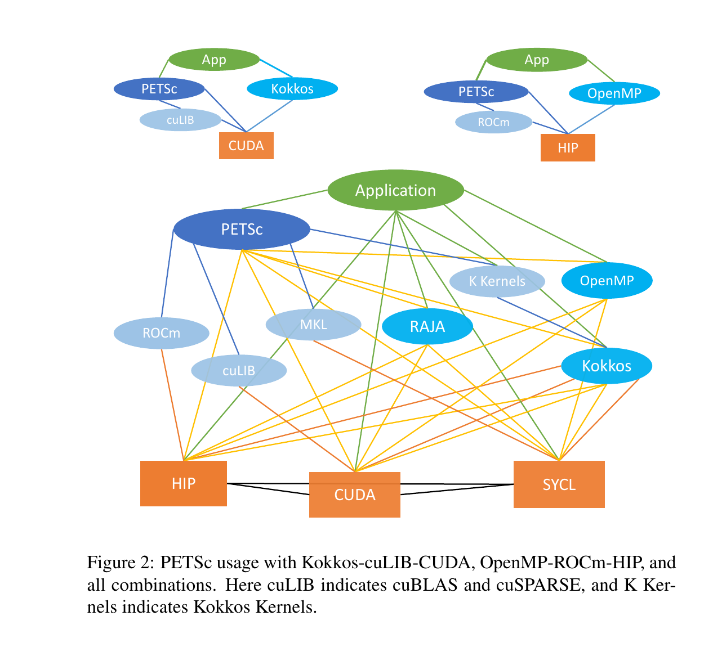
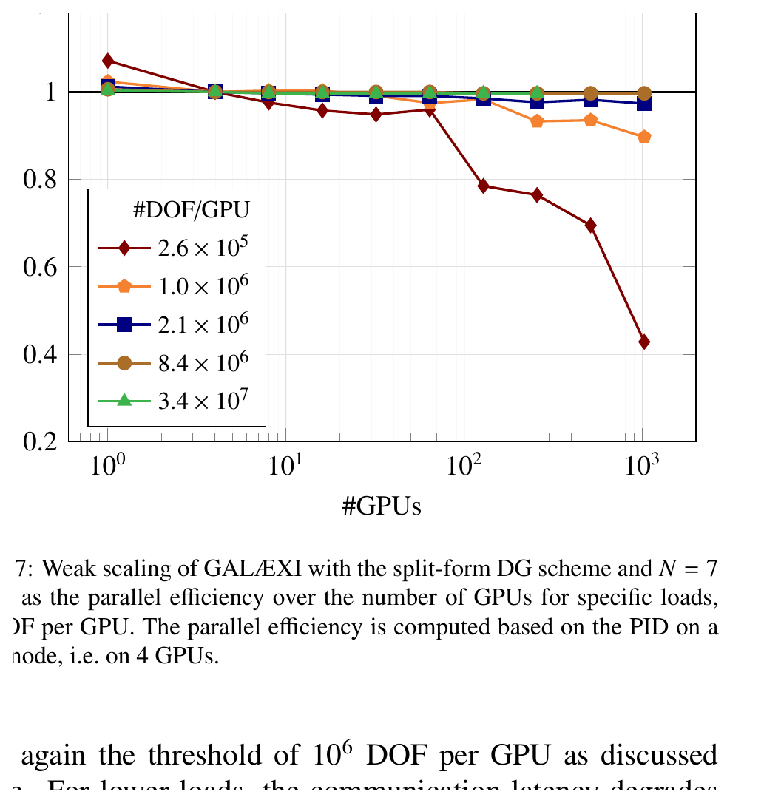
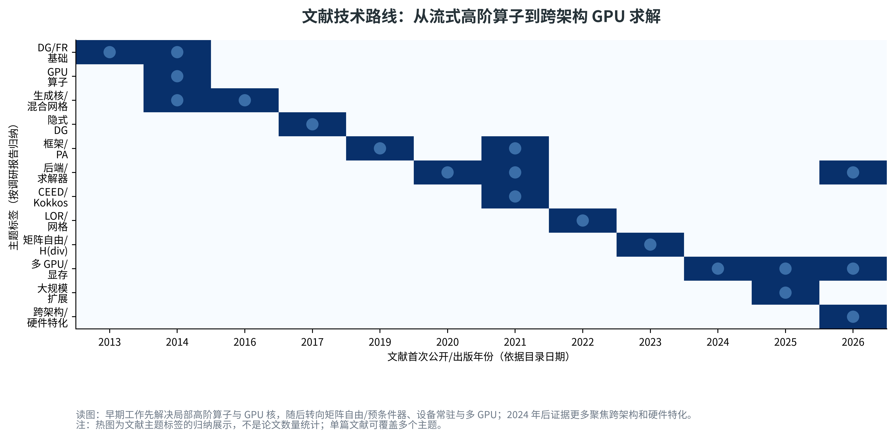
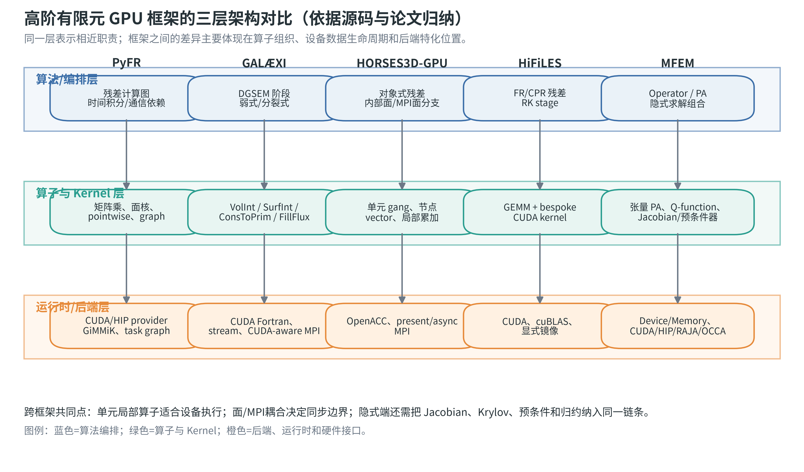
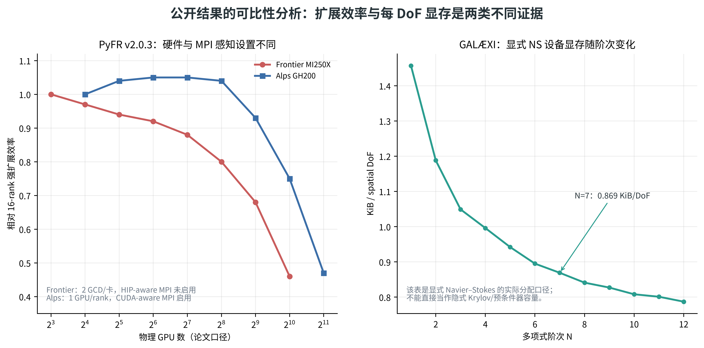

# 高阶有限元与 DG/FR GPU 加速文献调研报告

资料截止：2026-10-28。近十年相关论文、图书、手册与知识库整理。本报告基于 `review/ref-paper/` 的25条去重论文记录、固定源码快照及官方手册，重点回答四个问题：高阶 DG/FR 如何拆分 GPU Kernel；数据和算子如何组织；隐式求解和预条件器如何进入 GPU 链条；CUDA/HIP/多GPU和性能可移植性如何实现。

本报告不是按论文摘要简单罗列，而是按研究问题综合。论文分为三种证据状态：**全文证据**（本地PDF及可搜索文本）、**作者仓库源稿**（HiFiLES论文源稿）、**元数据证据**（尚未取得全文，只用于确认题名、作者、年份和检索方向）。文献索引、全文路径和逐篇阅读范围见[文献索引与阅读摘要](../ref-paper/文献索引与阅读摘要.md)；源码事实见[源码证据索引](04_源码证据索引.md)。

## 1. 文献集合与调研方法

### 1.1 文献范围

| 类别                    | 文献编号                               | 数量 | 证据状态                        | 用途                                            |
| ----------------------- | -------------------------------------- | ---: | ------------------------------- | ----------------------------------------------- |
| 高阶 DG/FR 求解器       | P01–P04、P09、P10、P13–P15、P18、P21 |   11 | 10篇全文、1份源稿               | 研究残差流程、单元算子、GPU迁移和多GPU          |
| 高阶有限元 GPU/矩阵自由 | P05–P08、P11、P12、P16、P17、P20      |    9 | 全文                            | 研究PA、矩阵自由、预条件器、内存和Kernel        |
| 可移植性/后端架构       | P19、P23–P25                          |    4 | P19全文，P23–P25主要为元数据   | 研究应用层与后端层分离、Kokkos/RAJA/PETSc等路线 |
| 早期基础方法            | P13、P14、P21、P22                     |    4 | 全文或源稿，其中P22仅元数据     | 解释现有框架的历史来源，不纳入近十年性能排名    |
| 合计                    | P01–P25                               |   25 | 20篇本地PDF、1份源稿、4条元数据 | 去重后的本地知识库                              |

时间窗为2016-10-28至2026-10-28。P13/P14/P21/P22早于时间窗，作为方法基础单列；不能把它们的旧硬件结果当作当前性能证据。P03、P09、P10、P11属于2026年预印本或出版记录，报告中注明其版本状态。

### 1.2 检索与筛选

检索围绕“高阶有限元/GPU/DG/FR/矩阵自由/隐式求解/多GPU/性能可移植性”展开，并通过论文引用回溯到 PyFR、FLEXI/GALÆXI、HORSES3D、MFEM、HiFiLES、CEED、PETSc、Kokkos 和 GiMMiK。纳入条件是：论文直接描述目标软件、GPU高阶算子、设备内存/通信、隐式预条件器或后端抽象；仅在摘要中提到GPU而没有实现关联的条目不进入主要结论。

初始部分Crossref并发查询触发429，随后使用OpenAlex发现、arXiv摘要/PDF、Crossref逐DOI核验和官方仓库固定提交交叉确认。没有取得全文的文献只用于书目和后续阅读计划，不据此填写性能数字或软件能力。

## 2. 研究发展脉络

### 2.1 2013—2016：流式高阶方法与专用矩阵核

P13提出PyFR的流式架构，P14进一步处理混合非结构网格的异构执行，P21展示HiFiLES的ESFR/FR多GPU路线。这一阶段的共同特征是：高阶单元内部存在大量局部张量运算，解在单元之间通过面通量耦合，因此可以把单元内部计算放到GPU，把面数据作为通信边界。

P22的GiMMiK代表另一条路线：对固定尺寸矩阵乘生成专用加速器Kernel。它说明高阶方法中“导数矩阵/插值矩阵乘”不必一律交给通用GEMM，也可以根据矩阵常量、尺寸、对齐和硬件资源生成专用代码。当前PyFR源码中的GiMMiK provider与这一思路直接对应，但P22全文未取得，具体历史性能不写入本报告。

### 2.2 2019—2021：框架化、部分组装和性能可移植性

P15的FLEXI建立了面向高阶守恒律的DGSEM软件框架，P05的MFEM把有限元空间、算子、设备和求解器组织为可组合库。P16/P17从高阶离散协同设计和CEED生态总结了GPU算子、张量分解和矩阵自由方向；P19进一步强调应用编程模型与库内部后端可以分离。

这一阶段的重要变化是：GPU移植不再只是为循环添加设备指令，而是开始明确区分算子表示、内存生命周期、设备后端和求解器组合。对HyRES而言，这与评审意见提出的“抽象接口层”直接相关。

### 2.3 2021—2023：矩阵自由、低阶预条件和大规模求解

P06把高阶算子作用与低阶细化（LOR）预条件器组合，并将setup、apply和AMG求解放到GPU；P07通过MFEM、RAJA和Umpire研究高阶流体应用的矩阵自由、执行抽象和分配管理；P08将高阶部分组装用于GPU网格优化；P12研究高阶H(div)问题的矩阵自由鞍点求解。

这些工作共同说明：对高阶隐式问题，减少高阶全矩阵存储只是第一步，必须同时设计预条件器、Krylov向量、归约和多级求解。显式残差Kernel的加速不能直接推导隐式端到端加速。

### 2.4 2024—2026：产业规模、跨架构和硬件特化

P01报告PyFR v2.0.3在AMD MI250X和NVIDIA GH200上的大规模多GPU扩展；P02报告GALÆXI在A100上的DGSEM扩展、显存和PID；P03报告HORSES3D-GPU在H100上的OpenACC多GPU实现；P09讨论保留Fortran控制层并通过接口连接CUDA/HIP C++ Kernel；P10报告GALÆXI在AMD MI300A APU上的分区模式和弱扩展；P11研究MFEM在FP64 Tensor Core上的高阶Kernel融合。

当前趋势可以概括为三点：

1. 设备常驻和通信重叠成为大规模性能的基本条件；
2. CUDA/HIP等原生后端仍用于关键Kernel特化，抽象层并不意味着放弃原生优化；
3. 性能评价从单Kernel速度转向每DoF时间、功耗、扩展效率、显存和完整求解时间。

## 3. 主题一：高阶 DG/FR 的算子和 Kernel 组织

### 3.1 单元内部与面耦合的分工

P13/P14、P02、P03和P21都体现了同一数值结构：单元内部的插值、导数、物理通量和体积分具有较高局部性；内部面、边界面和MPI面承担单元之间的耦合。适合GPU的流程通常为：

```text
单元状态 → 体/面插值 → 原始变量/梯度
        → 体通量与数值面通量
        → 导数/面积分 → 残差或QDot
```

但是各框架的Kernel边界不同：PyFR用图和provider组织依赖；GALÆXI将方向导数、体积分和面通量拆为CUDA Fortran核；HORSES3D-GPU用OpenACC gang/vector表达单元/节点并行；HiFiLES将固定算子交给GEMM或bespoke CUDA核；MFEM使用部分组装和张量Kernel。

因此，研究文献时不能只按“每个单元一个block”归纳。Kernel映射受阶次、变量数、单元类型、面邻接、共享内存、寄存器、批量和通信布局共同决定。

### 3.2 固定线性算子与非线性物理核

高阶方法中的导数矩阵、插值矩阵和lift矩阵是常量或低频变化量，适合：

- 批量GEMM；
- 张量积/一维分解；
- 专用生成Kernel；
- 将读入、物理计算和写回融合的点核。

非线性物理通量、边界条件和限制器则具有分支、临时变量和模型相关性，适合单独设计和验证。P21/P22说明早期框架已经采用“线性算子库/专用核 + 点物理核”组合；P16/P20从CEED/高阶有限元角度进一步抽象了元素算子、基函数和积分点物理。

对HyRES的启示是：应首先建立算子分类表，把残差计算分成固定矩阵类、点物理类、面耦合类、归约类和求解器类，再决定融合或后端实现。把整个残差函数作为一个Kernel，或者按每个源文件函数机械拆分，都缺少可调优粒度。

### 3.3 Kernel融合的边界

文献和源码共同支持以下判断：

- 相邻算子共享中间数据且不存在跨单元依赖时，融合可能减少全局内存写回；
- 需要MPI交换、全局归约或不同单元类型时，融合会破坏并行边界；
- 过度融合会增加寄存器、共享内存和分支，降低占用率；
- 小阶次/小批量时，Kernel启动和索引开销可能超过算术计算；
- 高阶、大批量时，张量/矩阵核的访存和缓存行为可能成为主要限制。

P11进一步说明，在特定硬件上对FP64 Tensor Core进行局部特化可以改善关键Kernel，但这属于硬件/Kernel级优化，不等于完整求解器获得相同比例加速。

## 4. 主题二：数据布局、矩阵自由和部分组装

### 4.1 为什么高阶方法倾向矩阵自由

P20指出，传统稀疏矩阵的每个非零元只带来很少浮点运算，却需要持续从显存加载；随着多项式阶次增加，完整矩阵存储和访存成本迅速上升。部分组装/矩阵自由方法只存储积分点系数、几何量或必要局部数据，在算子作用时即时完成基函数和积分变换。

P05/P08/P16/P17中反复出现的算子分解可以抽象为：

```text
全局自由度
→ 子域/单元限制
→ 基函数/梯度求值
→ 积分点物理系数
→ 反向基函数作用
→ 全局汇集
```

该分解把MPI拓扑、单元映射、张量运算和点物理分开，便于分别选择CPU/GPU实现。对DG面项，还要增加面限制和数值通量通道，不能把连续Galerkin的体算子直接套用。

### 4.2 存储收益与隐藏成本

矩阵自由减少了高阶全局矩阵，却引入了：

- 积分点系数和几何数据；
- 基函数/导数矩阵或其压缩表示；
- 面限制、邻接和halo缓冲；
- 临时张量和共享内存工作区；
- 预条件器需要的低阶矩阵或层次结构。

P07展示了Umpire池化、临时分配和缓冲复用对实际应用显存的影响；P02展示了高阶阶次改变每DoF显存的原因；P06展示了高阶算子和低阶预条件器的组合。三者共同说明，显存分析必须按生命周期分类，不能只统计主状态数组。

### 4.3 对 HyRES 的可执行记录项

每个数组至少登记：

| 字段     | 说明                                              |
| -------- | ------------------------------------------------- |
| 数值语义 | 状态、残差、梯度、通量、几何、Krylov或预条件器    |
| 空间位置 | 单元节点、积分点、面点、MPI面或全局标量           |
| 维度     | `nvar`、阶次、单元数、面数、方向数              |
| 布局     | AoS/SoA/AoSoA、连续维、leading dimension、padding |
| 生命周期 | 初始化、每步、每Newton步、每线性迭代、输出时      |
| 所有权   | CPU、GPU、双副本、临时池或外部库                  |
| 同步约定 | 写入队列、读入队列、事件、MPI请求                 |
| 峰值贡献 | 分配字节、有效字节、峰值时刻                      |

## 5. 主题三：隐式时间推进、Jacobian和预条件器

### 5.1 公开文献覆盖范围

P18是与隐式GPU最直接相关的高阶DG论文之一：非线性对流显式处理，Stokes部分隐式处理，压力系统使用CG和GPU多重网格，并用经验roofline分析Kernel。它证明了高阶DG隐式求解可以把线性求解器和预条件器纳入GPU链条，但其不可压缩压力问题与HyRES可压缩NS的完整Jacobian并不相同。

P06和P12从高阶有限元角度补充了矩阵自由、LOR/AMG、Schur补和块预条件器。P19从PETSc架构角度说明，应用层的离散和求解器库内部的后端可以分开，且可以组合Kokkos、RAJA、SYCL、HIP、CUDA等执行模型。

### 5.2 隐式GPU最容易被低估的成本

隐式端到端时间至少包括：

```text
残差/线性化
+ Jacobian作用或矩阵构造
+ Krylov向量读写
+ 预条件器 setup/apply
+ 点积/范数/线搜索归约
+ MPI halo与全局归约
+ 外Newton迭代与停止判断
```

如果Jacobain作用在GPU而预条件器在CPU，或每次归约都回传主机，单个残差Kernel即使加速，完整求解也可能变慢。文献中的setup/apply/solve分项数据正是为了避免把不同阶段混成一个数字。

### 5.3 对 HyRES 的文献结论

- 先确认HyRES当前Jacobian是解析、自动微分、有限差分、矩阵组装还是MatrixFree；
- 再确认线性求解器和预条件器的调用边界；
- 将残差、Jacobian作用、预条件器和归约分别列为后端覆盖项；
- 用相同非线性/线性停止准则比较完整时间，而不是比较固定迭代次数；
- 将“GPU覆盖率”定义为完整隐式时间占比，不定义为已迁移Kernel数量。

## 6. 主题四：CUDA、HIP、Kokkos及性能可移植性

### 6.1 原生后端和抽象层的关系

P09讨论Fortran控制层通过接口调用CUDA/HIP C++ Kernel；P19讨论应用层编程模型与库后端分离；P23/P25是Kokkos生态和Kokkos 3的书目信息，当前未取得全文，不据此推导性能数字。源码方面，PyFR已经把CUDA/HIP后端分成不同provider；MFEM把Device、Memory和Operator作为更完整的抽象。

文献和源码支持的稳妥结论是：

1. 抽象层可以减少算法代码重复，但必须携带执行空间、数据布局、异步事件、内存所有权和错误语义；
2. 对性能敏感的固定矩阵、归约、通信或硬件指令，可以通过特化后端或原生Kernel替换；
3. 抽象层不能隐藏所有差异，否则会产生隐式拷贝、过度同步或无法表达设备直达MPI；
4. “支持CUDA/HIP”只表示后端路径存在，不表示所有物理、时间推进、隐式和通信功能均已验证。

### 6.2 Kokkos在知识库中的准确位置

Kokkos相关资料目前包括项目已有 `refcode/kokkos-4.5.01`、官方Programming Guide快照以及P23/P25书目信息。可据此研究执行空间、视图、并行策略和内存空间，但不应把Kokkos的通用能力直接等同于HyRES的GPU/DCU适配结果。DCU还需结合DTK/HIP兼容性、RCCL、设备MPI和编译器实际验证。

### 6.3 原生特化的边界

P11的FP64 Tensor Core工作和P22的GiMMiK思路说明：当通用抽象层无法充分利用矩阵指令、共享内存或特殊访存模式时，原生特化有价值。推荐的工程形式是：

```text
算法接口
  → 后端公共实现（Kokkos/通用HIP/CUDA）
  → capability查询
  → 原生特化Kernel（满足同一输入/输出/误差契约）
  → 公共实现回退
```

这样既避免把上层算法写死在Kokkos，也避免把每个Kernel都复制成CUDA/DCU两份。

## 7. 主题五：多 GPU、通信和扩展性

### 7.1 文献中的三类通信路径

已收集框架大致呈现三种路径：

| 路径             | 代表资料         | 过程                                   | 主要风险                                |
| ---------------- | ---------------- | -------------------------------------- | --------------------------------------- |
| 设备缓冲直接通信 | GALÆXI源码/论文 | device pack→MPI→device unpack        | 发送前stream同步、MPI设备指针和接收事件 |
| 图/事件驱动通信  | PyFR             | 图中注册请求、pack、send、unpack和依赖 | 图能力、MPI后端和依赖正确性             |
| 主机中转         | HiFiLES源码      | device pack→D2H→MPI→H2D             | PCIe/主机内存带宽和同步                 |
| 指令式对象路径   | HORSES3D-GPU     | OpenACC present/async + MPI面集合      | 深拷贝、队列依赖、编译器实现差异        |

“采用MPI+GPU”本身不能说明通信方式；性能报告必须记录设备直达、主机中转、同步和MPI等待。

### 7.2 强扩展与弱扩展

P01、P02、P03和P10给出了不同软件/硬件的多GPU结果，但基准不同：

- PyFR固定TGV问题，从16 ranks扩展到2048 ranks；
- GALÆXI用每GPU负载和PID观察并行效率；
- HORSES3D-GPU以每卡16,384单元进行弱扩展；
- GALÆXI APU论文以每APU 4.096M空间DoF进行弱扩展。

这些数字不能合成统一排行榜。正确的复测必须固定：全局/局部问题规模、阶次、变量数、时间步、精度、MPI映射、互连和计时边界。

### 7.3 规模阈值的解释

高阶GPU程序通常存在一个“每卡最小有效负载”：负载过小，Kernel启动、MPI延迟和归约占比高；负载足够大，设备带宽和并行度被充分利用。P02/P03都观察到类似现象，但阈值随阶次、单元类型、方程、硬件和通信拓扑变化。不能将一个软件的“每卡最低单元数”作为HyRES的固定指标，应通过负载扫描得到。

## 8. 主题六：精度、硬件特化和能耗

P01提供FP64的跨AMD/NVIDIA强扩展；P10提供AMD MI300A的分区模式；P11关注FP64 Tensor Core；P02/P03提供A100/H100的每DoF和负载特征。这些文献共同说明：

- FP64、FP32和混合精度必须分别记录误差、收敛、吞吐和显存；
- MI250X的GCD、MI300A的SPX/TPX/CPX和NVIDIA物理GPU不能混为同一设备单位；
- 低精度中间计算可能改变非线性收敛和守恒误差；
- FP64硬件特化的收益取决于算子是否适合矩阵指令，不能用理论峰值替代实际Kernel测试；
- 只报告时间不报告功耗，会遗漏大规模GPU运行的实际资源成本，P02中的EPID讨论提供了更完整的比较思路。

对任务书要求的单精度/双精度支持，应建立同一算例、同一误差和同一停止准则下的精度矩阵，而不是只检查模板类型能够编译。

## 9. 主题七：网格/阶次自适应与本项目的关联

P08研究高阶有限元部分组装和GPU网格优化，核心是固定拓扑下的节点移动、张量化算子和矩阵自由实现；它对几何更新和高阶网格优化有参考意义，但不是目标量驱动的伴随p自适应。P04的HORSES3D主框架包含静态/动态p自适应背景，但GPU版的功能覆盖需要单独核实。

因此，现有文献可以支持：

- 高阶几何/网格数据的GPU存储和更新；
- 阶次变化后局部数据、算子表和工作区的重建；
- 自适应后负载不均衡和重新分区的性能风险。

现有文献不能直接支持：

- HyRES特定目标量伴随误差估计的实现正确性；
- 伴随方程与原方程在GPU上的完整求解链；
- 自适应前后相同精度目标下的端到端加速。

这些内容需要结合HyRES的算法和代码分析另行设计。

## 10. 面向 HyRES 的文献结论矩阵

| HyRES问题         | 直接参考文献                      | 可迁移结论                                  | 必须重新验证的内容                     |
| ----------------- | --------------------------------- | ------------------------------------------- | -------------------------------------- |
| DG/CPR残差拆分    | P01、P02、P03、P21                | 单元内部、面、MPI面和归约应分职责           | HyRES实际调用顺序、单元/阶次分布       |
| 固定矩阵/张量算子 | P02、P16、P20、P22                | 张量分解、PA、生成核和GEMM可作为候选        | HyRES矩阵尺寸、重复使用率、融合收益    |
| GPU内存管理       | P02、P05、P07、P08                | 设备常驻、有效性跟踪、池化和工作区复用      | HyRES每类数组生命周期及峰值            |
| 隐式线性求解      | P06、P12、P18、P19                | MatrixFree/LOR/AMG/块预条件器是可研究路线   | Jacobian、Krylov、预条件和归约调用链   |
| CUDA/HIP/DCU后端  | P01、P09、P19、P23、P25           | 算法层与后端层分离，关键Kernel可特化        | DTK/DCU编译、MPI、RCCL和精度支持       |
| 多GPU通信         | P01、P02、P03、P10                | 设备常驻、halo分层、强/弱扩展分别测量       | HyRES halo大小、同步点、互连和rank映射 |
| 自适应/高阶网格   | P04、P08                          | 高阶数据和网格更新可做矩阵自由/设备化       | 伴随误差指标、p调整和重分区            |
| 性能评价          | P01、P02、P03、P06、P07、P10、P11 | PID、显存、扩展、能耗和端到端时间应并列记录 | 任务书算例、统一硬件和完整求解边界     |

## 11. 研究空白与后续阅读优先级

### 11.1 目前知识库仍缺少的证据

1. 面向节点型高阶 DG/CPR **隐式可压缩NS**的完整GPU端到端公开对比仍不足；
2. 国产DCU/DTK上高阶DG/FR、隐式求解、设备MPI和RCCL的公开同口径数据不足；
3. 伴随自适应、局部p调整、GPU负载重分配和隐式求解结合的资料不足；
4. Kokkos、HIP、CUDA、OpenMP/OpenACC在同一个高阶CFD算例上的统一实测不足；
5. 公开论文通常只报告部分Kernel、单卡或扩展结果，完整显存分类和I/O边界不总是提供。

### 11.2 优先级A：直接支撑整体方案讨论

- P01：PyFR v2后端、图执行、CUDA/HIP、强扩展；
- P02：GALÆXI体/面Kernel、设备常驻、显存和A100扩展；
- P03：HORSES3D-GPU的OpenACC对象迁移和H100多GPU；
- P06/P18：高阶隐式或预条件器GPU链；
- P19/P20：应用层与后端层抽象、元素算子接口。

### 11.3 优先级B：支撑实现细化

- P07/P08：内存分配、矩阵自由和几何/网格相关优化；
- P09/P10：跨架构Fortran/C++接口、AMD APU和设备分区；
- P11/P16/P17：硬件特化、Tensor Core、高阶GPU算法；
- P04/P15：FLEXI/HORSES3D算法和软件结构背景。

### 11.4 优先级C：补充知识库

- P23/P25：Kokkos生态和Kokkos 3书目，当前需补全文；
- P24：五种共享内存编程模型的高阶CFD性能可移植性比较，当前仅元数据；
- P22：GiMMiK全文，补充生成矩阵Kernel的原始性能分析；
- B01/B02：GPU并行编程与守恒律数值方法图书，当前仅书目元数据。

## 12. 文献调研结论

近十年文献已经形成相对清晰的技术路线：高阶方法通过单元局部性获得GPU并行度，矩阵自由/部分组装控制高阶存储，设备常驻和分层通信支撑多GPU扩展，抽象后端负责降低代码重复，原生特化负责恢复关键Kernel性能，隐式求解则需要把Jacobian、预条件器、归约和线性迭代纳入同一端到端闭环。

这条路线可以支撑HyRES GPU改造方案的**问题分解和方案讨论**，但不能替代HyRES自身的代码流程、热点和数据生命周期分析。当前最稳妥的后续顺序是：

```text
HyRES显式/隐式调用链与热点
→ 对照本报告的算子/数据/求解器分类
→ 选择公共抽象接口边界
→ 以Kokkos/通用后端形成基线
→ 对关键Kernel加入CUDA/DCU特化
→ 统一正确性、显存、单卡、多卡和隐式端到端验证
```

本报告不把任何参考框架或论文性能数字直接写成HyRES承诺指标；所有最终指标仍应回到任务书算例、统一硬件和可复核日志。

## 13. 主要文献入口

- [P01 PyFR v2.0.3](../ref-paper/fulltext/P01_PyFR_v2.pdf)；[本地文献](../ref-paper/fulltext/P01_PyFR_v2.pdf)
- [P02 GALÆXI](../ref-paper/fulltext/P02_GALAEXI.pdf)；[本地文献](../ref-paper/fulltext/P02_GALAEXI.pdf)
- [P03 HORSES3D-GPU](../ref-paper/fulltext/P03_HORSES3D_GPU.pdf)；[本地预印本](../ref-paper/fulltext/P03_HORSES3D_GPU.pdf)
- [P05 MFEM](../ref-paper/fulltext/P05_MFEM.pdf)；[本地文献](../ref-paper/fulltext/P05_MFEM.pdf)
- [P06 LOR GPU](../ref-paper/fulltext/P06_LOR_GPU.pdf)；[本地文献](../ref-paper/fulltext/P06_LOR_GPU.pdf)
- [P07 MFEM/RAJA/Umpire](../ref-paper/fulltext/P07_MFEM_RAJA.pdf)；[本地文献](../ref-paper/fulltext/P07_MFEM_RAJA.pdf)
- [P09 GALÆXI architecture-agnostic](../ref-paper/fulltext/P09_GALAEXI_v2.pdf)；[本地预印本](../ref-paper/fulltext/P09_GALAEXI_v2.pdf)
- [P10 GALÆXI APU](../ref-paper/fulltext/P10_GALAEXI_APU.pdf)；[本地预印本](../ref-paper/fulltext/P10_GALAEXI_APU.pdf)
- [P16 GPU Algorithms for Efficient Exascale Discretizations](../ref-paper/fulltext/P16_GPU_CEED.pdf)；[本地文献](../ref-paper/fulltext/P16_GPU_CEED.pdf)
- [P18 GPU DG incompressible flow](../ref-paper/fulltext/P18_GPU_DG_INS.pdf)；[本地预印本](../ref-paper/fulltext/P18_GPU_DG_INS.pdf)
- [P19 PETSc GPU](../ref-paper/fulltext/P19_PETSc_GPU.pdf)；[本地预印本](../ref-paper/fulltext/P19_PETSc_GPU.pdf)
- [P20 libCEED](../ref-paper/fulltext/P20_libCEED.pdf)；[本地文献](../ref-paper/fulltext/P20_libCEED.pdf)

完整25条记录、BibTeX、RIS及元数据见[文献索引与阅读摘要](../ref-paper/文献索引与阅读摘要.md)、[references.bib](../ref-paper/references.bib)、[references.ris](../ref-paper/references.ris)和[metadata/papers.json](../metadata/papers.json)。

## 14. 图表化文献方法与结果归纳

本节将文献调研中的架构、方法、流程和结果证据放在同一组图表中。所有原文图均保留来源和页码；自绘图仅按本地文献目录、已核实表格和源码索引作结构化归纳。

### 14.1 原文摘取：PETSc 的后端组合关系



**图14-1说明。**图源为 P19 PDF 第2页 Figure 2。图中展示了 Kokkos-cuLIB-CUDA、OpenMP-ROCm-HIP 以及更大的编程模型/库组合网络。原文强调应用可以选择编程模型，而 PETSc 内部后端也可以独立选择；这正好说明“算法层不重复、后端可替换”需要共享数据而不是复制一套应用对象。

**对本项目的意义。**该图可支持 Kokkos 作为公共执行/数据抽象的研究方向，但不等于 HyRES 已经完成 Kokkos、HIP、CUDA、DCU 或设备 MPI 的互操作。实施时仍需为 Layout、MemorySpace、Stream/Event、MPI buffer 和精度定义可测试契约。

### 14.2 原文摘取：GALÆXI 弱扩展结果



**图14-2说明。**图源为 P02 PDF 第13页 Figure 7，横轴为 GPU 数，曲线按每 GPU 的 DoF 负载区分。原文观察到较大负载在扩展过程中维持接近 1 的并行效率，而低负载在 GPU 数增加后明显下降。

**结果分析。**曲线表达的是特定 GALÆXI/DGSEM/A100 体系的弱扩展结果，不是所有高阶 DG 或 DCU 的通用阈值。其可迁移方法是进行每卡 DoF 扫描并记录通信/Kernel 边界；其不可迁移部分是具体阈值、网络拓扑、MPI 映射和 GPU 型号。HyRES 复测应把每卡空间 DoF、标量 DoF、变量数和 halo 字节同时记录。

### 14.3 自绘：文献技术路线图



**图14-3绘制依据。**图中年份来自 [文献目录.csv](../ref-paper/文献目录.csv) 的首次公开/出版日期，主题标签由本报告第2–9节逐篇归纳。热图的圆点是“该文献/年份涉及该主题”的标记，不是统计意义上的论文数量或引用次数。

**方法分析。**技术路线从 2013–2016 年的流式高阶算子、混合网格和生成矩阵核，逐渐转向 2019–2023 年的框架化、部分组装、矩阵自由、低阶预条件器和可移植后端，2024 年后重点转向多 GPU 扩展、设备常驻、跨架构接口和硬件特化。这个演进说明当前方案不能只做“循环加速”，还需要同步处理数据生命周期、隐式求解和通信。

### 14.4 自绘：架构和公开结果的联合证据





**图14-4–图14-5分析。**架构图把文献中的共性职责统一到算法、Kernel、后端三层；结果图则分别展示强扩展效率和每 DoF 显存，避免把不同物理问题、硬件和指标混成一条曲线。PyFR 的强扩展曲线显示不同 MPI 感知设置下的规模效率差异；GALÆXI 的显存曲线显示阶次变化会改变空间 DoF 的存储成本。两类图一起说明，架构可迁移性和性能可比性是两个独立问题：前者要求接口携带执行/内存语义，后者要求统一算例、精度、硬件、负载和计时边界。

### 14.5 文献结果证据表

| 结果类型            | 原文/数据来源                                                 | 本报告的使用方式                  | 不能外推的部分                           |
| ------------------- | ------------------------------------------------------------- | --------------------------------- | ---------------------------------------- |
| PyFR 强扩展         | P01 PDF 第17页 Tables 2–3、`raw_data/PyFR强扩展原始表.csv` | 说明规模效率与 MPI 感知设置的关系 | 不能外推到 HyRES/DCU 或隐式求解          |
| GALÆXI 弱扩展      | P02 PDF 第13页 Figure 7                                       | 说明每 GPU DoF 负载阈值和通信影响 | 不能把阈值当作通用硬件指标               |
| GALÆXI 每 DoF 显存 | P02 PDF 第13页 Table 2、`raw_data/GALAEXI显存原始表.csv`    | 说明阶次与存储比重的关系          | 不含隐式 Krylov/预条件器工作区           |
| HORSES3D-GPU 多 GPU | P03 PDF 第18页及正文                                          | 说明 OpenACC 对象迁移和弱扩展证据 | 预印本、H100、DGSEM口径不可替代 DCU 验证 |
| MFEM LOR/AMG        | P06 PDF 第16–17页                                            | 说明 setup/apply/solve 要分项测量 | 不是可压缩 DG 完整时间推进               |
| MFEM/RAJA/Umpire    | P07 PDF 第11–13页                                            | 说明分配池和矩阵自由的显存影响    | 181→97.3 GB 是12卡合计应用口径          |

### 14.6 对 HyRES 文献路线的收敛结论

图表把文献结论收敛为四个实现问题：

1. **架构问题：**建立算法层、算子层、后端层之间的稳定接口，Kokkos/通用 HIP 作为基线，CUDA/DCU 原生核作为可替换特化。
2. **方法问题：**按固定线性算子、点物理、面耦合、归约、通信和求解器拆分，而不是按源文件或循环机械拆分。
3. **流程问题：**用任务依赖和事件时间线描述设备常驻、MPI halo、等待和残差更新，保留正确性检查点。
4. **结果问题：**同时报告 Kernel、显存、通信、扩展和隐式端到端指标，并明确每项证据的硬件、精度和计时边界。

这些结论是对本地 25 条文献、7 份源码快照和已核实结果表的结构化归纳，不是 HyRES 已达到的性能承诺。HyRES 的最终方案仍需通过源码调用链、任务书算例和 DCU 实测闭环验证。
